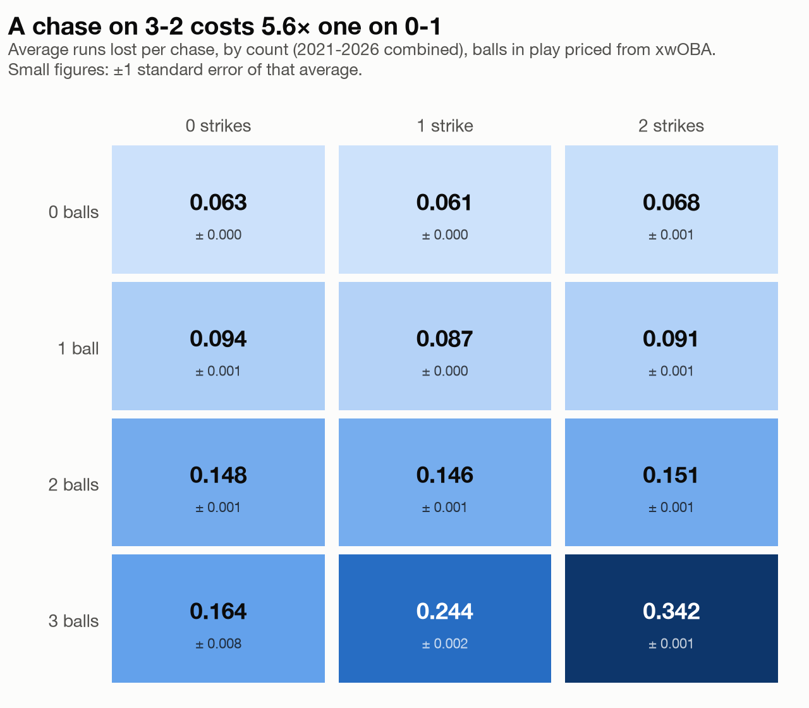
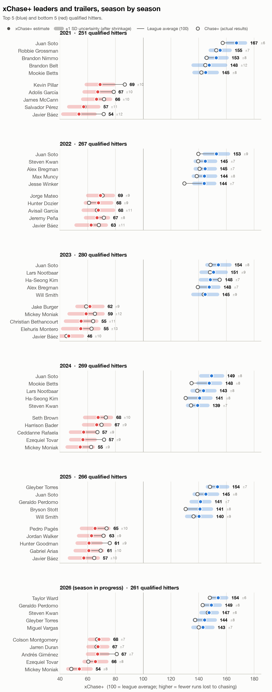
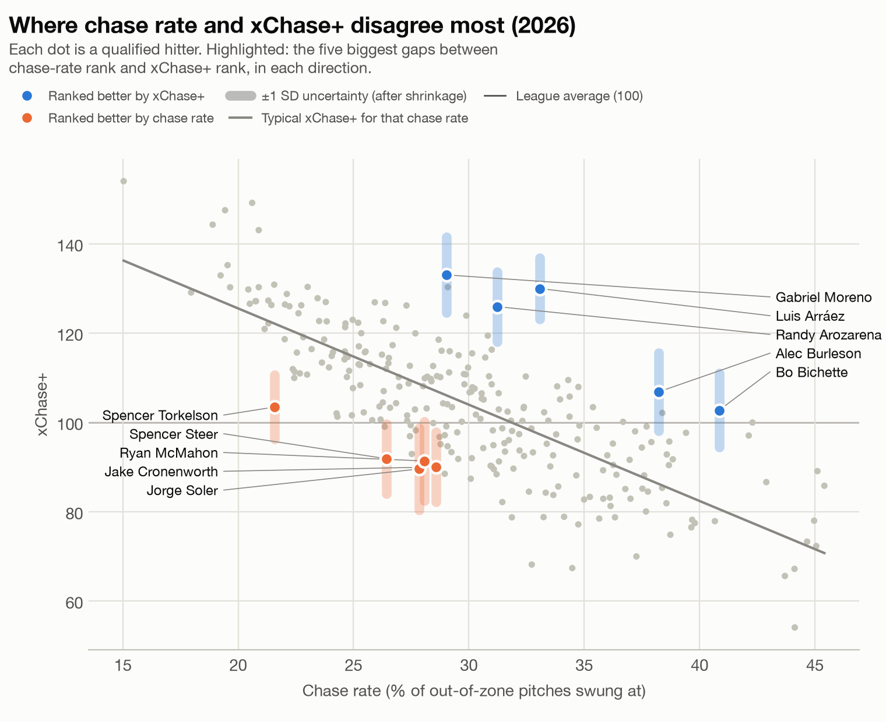
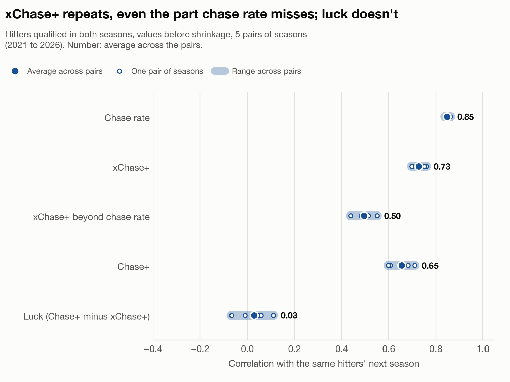
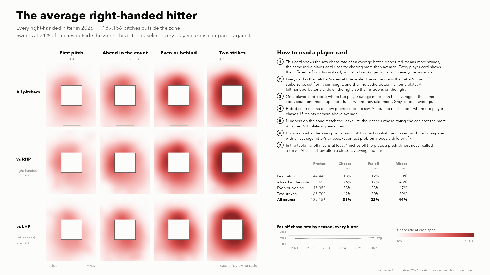
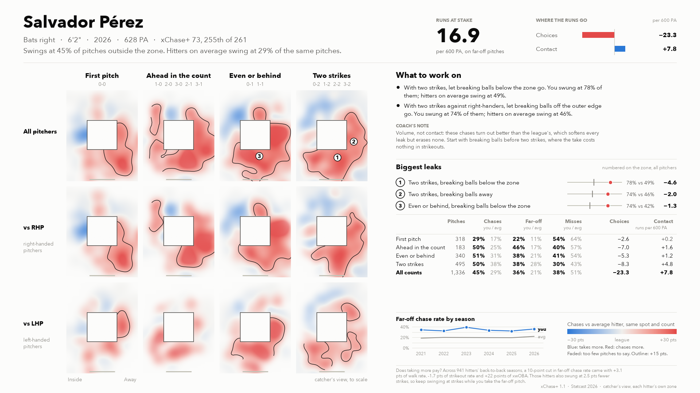
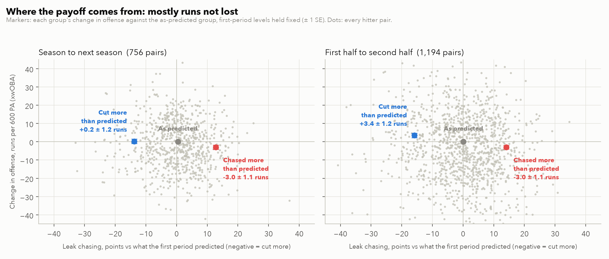
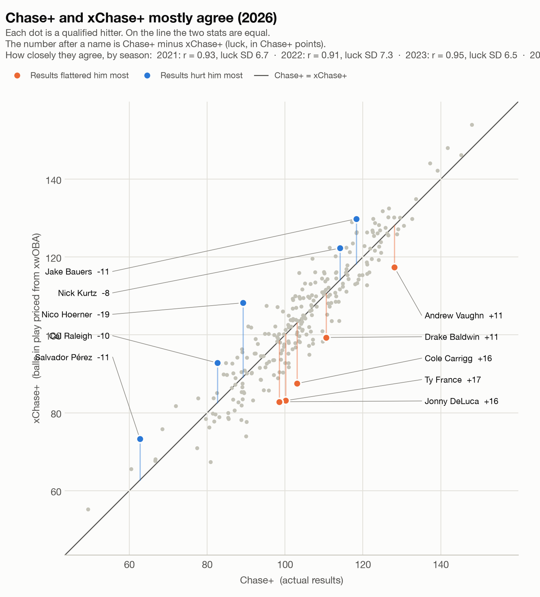

# Chase Value (xChase+ and Chase+)

**Everything, hosted:** [samuelosullivan6-rgb.github.io/ChasePlus](https://samuelosullivan6-rgb.github.io/ChasePlus/)
has every hitter's decision card, the roster by team, the noted hitters'
report with printable cards, and this write-up. Nothing to download.

Chase rate counts how often a hitter swings at pitches outside the zone,
and it treats every one of those swings as the same mistake. They aren't.
On average a chase on 3-2 costs about 5.6 times as many runs as a chase on
0-1. This project prices every chase decision in runs using Statcast data,
builds a per-season leaderboard, and then tests whether the numbers hold
up.

It reports two scores on the same scale:

- **xChase+** (the main number, version 1.1) prices a chase put in play
  by how it was hit, using Savant's xwOBA. It measures the decision and
  the contact, not where the ball landed, and it repeats better from one
  season to the next.
- **Chase+** (version 2.0) prices a chase put in play by what actually
  happened: the league value of a single, double, triple, home run or
  out, whatever the runners and outs were. It is the record of the
  season, luck included.

Takes, whiffs and fouls are priced the same way in both. The gap between
them (Chase+ minus xChase+) is called **luck** below. It's the same idea
as xwOBA next to wOBA. See [Version history](#version-history) for what
changed between versions.

**How to read the charts:** a solid mark (dot, line or bold number) is the
estimate. The pale band or bar behind it, or the small ± figure, is its
uncertainty. A thin gray line marks the league average (100).

## Results

### Why price chases instead of counting them

<picture>
  <source media="(prefers-color-scheme: dark)" srcset="results/xchase/figures/chase_cost_by_count_dark.png">
  
</picture>

A chase with three balls costs far more than one early in the count.
Chase rate treats those as the same mistake; this project doesn't.

### Leaders and trailers, season by season

<picture>
  <source media="(prefers-color-scheme: dark)" srcset="results/xchase/figures/leaderboard_by_season_dark.png">
  
</picture>

About 250-280 hitters qualify each season. An xChase+ of 130 is about the
top 7% of qualified hitters. The hollow ring is the same hitter's
Chase+; the line between them is luck. Full tables, with both scores and
the luck between them, are in `results/xchase/xchase_leaderboard_<season>.csv`.

<details>
<summary>Top 5 and bottom 5 as tables</summary>

**2021** (251 qualified hitters)

| Rank | Player | PA | Chase% | Runs saved / 600 PA | xChase+ ± 1 SD | Chase+ | Luck |
|---:|---|---:|---:|---:|---|---:|---:|
| 1 | Juan Soto | 635 | 12.2% | +24.5 | **167** ± 6 | 157 | -10 |
| 2 | Robbie Grossman | 668 | 15.7% | +20.3 | **155** ± 7 | 153 | -3 |
| 3 | Brandon Nimmo | 384 | 15.1% | +19.0 | **152** ± 8 | 145 | -7 |
| 4 | Brandon Belt | 378 | 19.0% | +17.6 | **148** ± 12 | 145 | -3 |
| 5 | Mookie Betts | 550 | 18.4% | +16.1 | **144** ± 8 | 141 | -3 |
| | ... | | | | | | |
| 247 | Kevin Pillar | 345 | 36.4% | -11.2 | **70** ± 10 | 87 | +18 |
| 248 | Adolis García | 622 | 35.8% | -12.1 | **67** ± 10 | 78 | +11 |
| 249 | James McCann | 412 | 32.1% | -12.2 | **67** ± 10 | 72 | +5 |
| 250 | Salvador Pérez | 660 | 45.3% | -15.4 | **58** ± 11 | 58 | +0 |
| 251 | Javier Báez | 547 | 44.7% | -17.0 | **54** ± 11 | 71 | +18 |

**2022** (267 qualified hitters)

| Rank | Player | PA | Chase% | Runs saved / 600 PA | xChase+ ± 1 SD | Chase+ | Luck |
|---:|---|---:|---:|---:|---|---:|---:|
| 1 | Juan Soto | 662 | 17.1% | +18.6 | **152** ± 9 | 139 | -13 |
| 2 | Alex Bregman | 655 | 18.2% | +15.8 | **144** ± 7 | 140 | -4 |
| 3 | Steven Kwan | 635 | 20.3% | +15.7 | **144** ± 7 | 139 | -5 |
| 4 | Max Muncy | 564 | 16.4% | +15.6 | **144** ± 8 | 138 | -6 |
| 5 | Jesse Winker | 546 | 18.6% | +15.5 | **144** ± 7 | 130 | -14 |
| | ... | | | | | | |
| 263 | Andrés Giménez | 550 | 38.9% | -11.1 | **69** ± 9 | 81 | +12 |
| 264 | Hunter Dozier | 500 | 33.0% | -11.2 | **69** ± 9 | 62 | -7 |
| 265 | Avisaíl García | 382 | 41.1% | -11.5 | **68** ± 11 | 67 | -1 |
| 266 | Jeremy Peña | 556 | 38.0% | -11.8 | **67** ± 8 | 72 | +5 |
| 267 | Javier Báez | 590 | 47.7% | -13.1 | **63** ± 11 | 69 | +5 |

**2023** (280 qualified hitters)

| Rank | Player | PA | Chase% | Runs saved / 600 PA | xChase+ ± 1 SD | Chase+ | Luck |
|---:|---|---:|---:|---:|---|---:|---:|
| 1 | Juan Soto | 706 | 16.6% | +20.4 | **154** ± 8 | 148 | -6 |
| 2 | Lars Nootbaar | 505 | 17.0% | +19.3 | **151** ± 9 | 148 | -3 |
| 3 | Ha-Seong Kim | 627 | 20.5% | +18.4 | **148** ± 7 | 155 | +7 |
| 4 | Alex Bregman | 721 | 18.7% | +17.8 | **147** ± 7 | 139 | -8 |
| 5 | Will Smith | 548 | 25.6% | +16.7 | **144** ± 9 | 143 | -1 |
| | ... | | | | | | |
| 276 | Jake Burger | 539 | 38.9% | -14.4 | **62** ± 9 | 59 | -3 |
| 277 | Mickey Moniak | 319 | 46.9% | -15.6 | **59** ± 12 | 65 | +6 |
| 278 | Christian Bethancourt | 333 | 45.3% | -16.8 | **56** ± 11 | 64 | +8 |
| 279 | Elehuris Montero | 306 | 43.7% | -17.0 | **55** ± 13 | 63 | +8 |
| 280 | Javier Báez | 542 | 44.4% | -20.0 | **47** ± 10 | 46 | -2 |

**2024** (269 qualified hitters)

| Rank | Player | PA | Chase% | Runs saved / 600 PA | xChase+ ± 1 SD | Chase+ | Luck |
|---:|---|---:|---:|---:|---|---:|---:|
| 1 | Juan Soto | 710 | 18.0% | +17.5 | **148** ± 8 | 148 | +0 |
| 2 | Mookie Betts | 516 | 21.2% | +17.0 | **147** ± 8 | 134 | -13 |
| 3 | Lars Nootbaar | 404 | 17.0% | +15.7 | **143** ± 8 | 139 | -4 |
| 4 | Ha-Seong Kim | 469 | 18.8% | +14.8 | **141** ± 8 | 131 | -10 |
| 5 | Steven Kwan | 543 | 19.2% | +14.2 | **139** ± 7 | 135 | -5 |
| | ... | | | | | | |
| 265 | Korey Lee | 395 | 35.2% | -11.7 | **68** ± 9 | 69 | +2 |
| 266 | Harrison Bader | 434 | 33.6% | -12.2 | **66** ± 9 | 70 | +3 |
| 267 | Ezequiel Tovar | 695 | 43.8% | -15.4 | **57** ± 9 | 72 | +15 |
| 268 | Ceddanne Rafaela | 569 | 46.7% | -15.6 | **57** ± 9 | 67 | +10 |
| 269 | Mickey Moniak | 418 | 39.1% | -16.6 | **54** ± 9 | 62 | +8 |

**2025** (266 qualified hitters)

| Rank | Player | PA | Chase% | Runs saved / 600 PA | xChase+ ± 1 SD | Chase+ | Luck |
|---:|---|---:|---:|---:|---|---:|---:|
| 1 | Gleyber Torres | 627 | 17.2% | +19.5 | **153** ± 7 | 147 | -5 |
| 2 | Juan Soto | 707 | 15.9% | +16.4 | **144** ± 8 | 138 | -6 |
| 3 | Geraldo Perdomo | 720 | 19.0% | +15.1 | **141** ± 7 | 141 | +0 |
| 4 | Bryson Stott | 563 | 23.4% | +14.9 | **140** ± 8 | 130 | -10 |
| 5 | Will Smith | 438 | 19.4% | +14.9 | **140** ± 9 | 136 | -4 |
| | ... | | | | | | |
| 262 | Pedro Pagés | 388 | 35.9% | -12.9 | **65** ± 10 | 73 | +8 |
| 263 | Jordan Walker | 394 | 34.1% | -13.5 | **63** ± 9 | 72 | +9 |
| 264 | Hunter Goodman | 577 | 36.9% | -14.4 | **61** ± 8 | 76 | +15 |
| 265 | Gabriel Arias | 470 | 39.0% | -14.4 | **61** ± 10 | 70 | +8 |
| 266 | Javier Báez | 435 | 46.2% | -15.7 | **58** ± 10 | 65 | +7 |

**2026** (261 qualified hitters)

| Rank | Player | PA | Chase% | Runs saved / 600 PA | xChase+ ± 1 SD | Chase+ | Luck |
|---:|---|---:|---:|---:|---|---:|---:|
| 1 | Taylor Ward | 606 | 15.0% | +23.7 | **154** ± 6 | 148 | -6 |
| 2 | Geraldo Perdomo | 681 | 20.6% | +21.1 | **148** ± 6 | 142 | -6 |
| 3 | Steven Kwan | 637 | 19.4% | +20.3 | **146** ± 6 | 145 | -1 |
| 4 | Gleyber Torres | 419 | 18.9% | +19.4 | **144** ± 7 | 137 | -7 |
| 5 | Miguel Vargas | 696 | 20.9% | +18.5 | **142** ± 7 | 139 | -3 |
| | ... | | | | | | |
| 257 | Colson Montgomery | 633 | 32.7% | -14.0 | **68** ± 7 | 67 | -1 |
| 258 | Jarren Duran | 607 | 34.5% | -14.2 | **68** ± 7 | 67 | -1 |
| 259 | Andrés Giménez | 503 | 44.1% | -14.4 | **67** ± 7 | 81 | +14 |
| 260 | Ezequiel Tovar | 508 | 43.7% | -15.1 | **66** ± 8 | 61 | -5 |
| 261 | Mickey Moniak | 435 | 44.1% | -19.7 | **55** ± 8 | 49 | -6 |

Luck is Chase+ minus xChase+. Hitters at the top of a list sorted by
xChase+ tend to have negative luck (and the bottom positive luck): that's
partly what put them at the extremes.

</details>

### What chase rate misses

<picture>
  <source media="(prefers-color-scheme: dark)" srcset="results/xchase/figures/chase_plus_vs_chase_rate_dark.png">
  
</picture>

Some hitters chase often but mostly when it's cheap, and some rarely
chase but pay for it when they do. The highlighted hitters are the
biggest disagreements between the two rankings. Compared like for like,
xChase+ correlates 0.30-0.35 with a hitter's xwOBA each season, against
0.23-0.30 (negative) for chase rate. See the appendix for how that's
measured, and for what it does and doesn't say about next season.

### Does it repeat?

<picture>
  <source media="(prefers-color-scheme: dark)" srcset="results/xchase/figures/reliability_chase_vs_xchase_dark.png">
  
</picture>

Yes. Across the five pairs of seasons from 2021 to 2026, xChase+ repeats at
r = 0.70-0.76 (0.72 on average), Chase+ at 0.60-0.71 (0.65), and luck not
at all (-0.07 to 0.11; 0.03). xChase+ beats Chase+ in every pair. That's
the reason xChase+ is the main number: taking the ball-in-play luck out
leaves more of the hitter. Both are noisier than plain chase rate (0.84-0.86),
which only counts chases and doesn't price them.

Chase rate alone explains 58-71% of the spread in xChase+ within a
season, so part of xChase+ repeating is just chase rate repeating. The
part chase rate doesn't explain (what's left after a straight-line fit
on chase rate, each season) still repeats at r = 0.43-0.55 (0.49). That
part is what pricing chases adds over counting them, and it carries over
from one season to the next. The same part of Chase+ repeats at
0.34-0.46 (0.40); xChase+ is ahead in every pair here too. The per-stat scatter
plots are in `results/xchase/figures/reliability.png` and
`results/chase/figures/reliability.png`.

### From a number to a plan: player decision cards

xChase+ says how many runs a hitter loses to chasing. A decision card says
where, and what to do about it. Every qualified hitter gets one, written so
a coach can hand it to a player and the player can read it alone.

**Open them:** [samuelosullivan6-rgb.github.io/ChasePlus](https://samuelosullivan6-rgb.github.io/ChasePlus/)
has every card ([the interactive page](https://samuelosullivan6-rgb.github.io/ChasePlus/results/xchase/player_cards/index.html))
and [the roster on one page](https://samuelosullivan6-rgb.github.io/ChasePlus/results/xchase/player_cards/teams.html),
served straight from this repository by GitHub Pages. No download needed.

Start with the average hitter. This card is the baseline: how often an
average right-handed hitter swings at a pitch outside the zone at each
spot, in each count, against each pitcher hand. Everyone chases more with
two strikes, and nobody should be judged for that.

<picture>
  <source media="(prefers-color-scheme: dark)" srcset="results/xchase/player_cards/reference/average_rhb_dark.png">
  
</picture>

A player card shows the difference from that baseline instead: red where
the player swings more than an average hitter would at the same spot, count
and matchup, blue where they take more. Here is Salvador Pérez, 255th of
261 by xChase+:

<picture>
  <source media="(prefers-color-scheme: dark)" srcset="results/xchase/noted_players/cards/salvador_perez_dark.png">
  
</picture>

How to read it, top to bottom:

1. **The header says what kind of problem it is.** Pérez's swing choices
   cost 23.3 runs per 600 PA, but those chases produce 7.8 more than an
   average hitter's would. The swing is fine; the choices are not. That
   makes it a coaching problem with a simple fix. The 16.9 "runs at stake"
   is the part from pitches at least 4 inches off the plate, the ones that
   are almost never called strikes.
2. **The zones show where.** The rectangle is Pérez's own strike zone at
   true height, seen from the catcher. Red runs below and away from it in
   every count, against both hands. The outlines mark spots 15 points or more
   above average. Faded areas had too few pitches to say anything.
3. **The numbers on the zones are the leaks**, ranked by runs. The worst
   is two-strike breaking balls below the zone: Pérez swings at 78%, where
   an average hitter on the same pitches swings at 49%.
4. **The plan is written to the player**, in the words a hitter would use
   in the cage: "With two strikes, let breaking balls below the zone go.
   You swung at 78% of them; hitters on average swing at 49%. The ones
   you swung at were typically 5 inches off the zone."
   That last sentence is on every plan line, so "let it go" is never
   read as "take the borderline pitch". The plan takes the card's first
   two leaks. When those explain less than a quarter of a loss of three
   runs or more, the plan opens by saying so and naming the count to
   start in: Trea Turner chases a little more than the league in every
   count and no one spot costs him a full run, so his first line says the
   7 runs are spread out and to start when he is ahead. Every sentence of
   the plan is written from the count table beside it, so a plan is empty
   only when that table agrees that no count costs a run, and a hitter
   who chases more with two strikes but produces there, like Luis Arráez,
   is told there is nothing to take away.
5. **The coach's note is for the staff.** It says where to start: breaking
   balls before two strikes, where a take costs nothing in strikeouts.
   A card says where a hitter chases, not why. The same leak can be
   pitch recognition, timing or a two-strike approach, and the drill is
   different for each, so the card says where to point the camera.
6. **The count table says whether he struggles there.** Next to his rates,
   the xwOBA column is the count check (below): every plate appearance
   that reached those counts, against the league's in the same counts.
   Once Pérez reaches two strikes he is at .226 against the league's .234,
   about average once noise is allowed for.
7. **The season trend says whether it is a habit or a slump.** Pérez has
   chased 32-39% of far-off pitches every season since 2021, against a
   league rate of 18-22%. It is a habit, so the plan is worth the effort.
8. **The target, under the leaks, is the number to beat.** Leaks are a
   hitter's worst-looking spots, so about half of the excess goes away
   on its own next season (see step 16 below). The card shows how far
   above the league he chased in his leaks this season and what the
   frozen line expects next season with no change at all. Only a number
   below that counts as a fix, and that is the number step 20 scores.

**Does taking more pay?** Before putting "take that pitch" on a card, step
14 checked what happened to real hitters who did it. Across 941 pairs of
back-to-back seasons, a 10-point cut in far-off chase rate came with:

| Change | Per 10-point cut in far-off chase rate |
|---|---:|
| Walk rate | +3.1 pts |
| Strikeout rate | -1.7 pts |
| xwOBA | +.022 |
| Swing rate at strikes | -2.5 pts |

The last row is the cost: hitters who cut chases also got a little more
passive on strikes. It is small next to the gain, and every card says it,
so the message to the player is to take the far-off pitch, not to stop
swinging.

### Checking the advice

Step 14 tests the general idea. Steps 15 and 16 test the cards themselves:
is the hitter actually struggling where his leaks are, and when hitters
fixed the exact leaks on their card, did it pay?

**The count check (step 15).** A leak is one pitch inside a count:
"two strikes, breaking balls below the zone." Nobody should rebuild a
hitter's whole two-strike approach over one pitch, so the check looks at
the count, not the pitch: how the hitter does once a plate appearance
reaches those counts. That is the xwOBA of every plate appearance that got
there, against the league's in the same counts.

The league comparison matters more than it looks. In 2026 the league's
xwOBA is .358 once a plate appearance reaches a hitter's count and .234
once it reaches two strikes, so a raw ".900 OPS after 2-0" is about
average, not hot. Most of a count split is also noise:

| xwOBA vs the league in the same counts | Split halves | Year to year |
|---|---:|---:|
| Overall | 0.57 | 0.66 |
| Ahead in the count, beyond his overall level | 0.05 | 0.07 |
| Even or behind, beyond his overall level | 0.17 | 0.29 |
| Two strikes, beyond his overall level | 0.36 | 0.53 |

How a hitter does when he's ahead in the count, once his overall level is
known, doesn't repeat at all. How he does with two strikes does. So the
check estimates the two parts separately (his overall level, and how much
better or worse he does in those counts) and shrinks each by how much
hitters really differ in it that season (DerSimonian-Laird). A hitter is
*struggling* in those counts when the estimate is at least 10 points of
xwOBA below the league, and *productive* when it is 10 above. On a
hitter's card it is the xwOBA column of the count table. The noted-hitters
report gives the verdict under each plan.

**Does fixing a leak pay? (step 16).** For every hitter qualified in
back-to-back seasons (761 pairs) and every qualified season split into
first and second halves at the hitter's own plate-appearance midpoint
(1,202 pairs), step 16 finds the first period's card leaks with the
card's own rule and watches the same spots in the next period.

The catch is regression to the mean. Leaks are a hitter's worst-looking
spots, so part of each one is bad luck. On average, how far above the
league a hitter chases in his leaks halves the next period with nobody
doing anything: from 15 points to 7 season to season, and from 16 to 7
half to half. So the test compares what each hitter did with what his
first period predicted, and every regression holds the first period's
level fixed. Standard errors are clustered by hitter.

Per 10-point cut in leak chasing beyond what was predicted:

| Change | Season to season | First half to second |
|---|---:|---:|
| xChase+ | +4.7 ± 0.6 | +4.3 ± 0.5 |
| Offense, runs per 600 PA (xwOBA) | +1.4 ± 0.5 | +2.0 ± 0.4 |
| Offense, runs per 600 PA (wOBA) | +0.9 ± 0.6 | +1.3 ± 0.5 |
| Walk rate | +0.8 pts | +0.5 pts |
| Strikeout rate | -0.1 pts | -0.3 pts |
| Swing rate at strikes | -0.5 pts | -0.3 pts |

Offense runs are batting runs above average built on xwOBA:
(xwOBA − league xwOBA) / wOBA scale × 600. That puts them in the same
units as xChase+'s runs, and xwOBA leaves out the ball-in-play luck that
wOBA (the next row) keeps. Each season's wOBA scale (1.20-1.23) is fit
from Savant's wOBA weights against this project's run values. wRC+ would
need park factors this data doesn't have, and OPS weights on-base and
slugging wrong.

**The run accounting holds up.** Each run of choices a hitter recovered
in his leaks, as the cards price it, came back as 0.75 ± 0.31 (season
pairs) and 1.21 ± 0.26 (halves) runs of xwOBA offense. Exactly 1 would
mean the card's runs are the runs a hitter gets back.

**The count check doesn't change the payoff.** Hitters gained about as
much from fixing a leak whether they were struggling in those counts or
hitting well there:

| In the leak's counts, first period | Season to season | First half to second |
|---|---:|---:|
| Struggling | +1.4 ± 1.2 (112 pairs) | +2.9 ± 0.9 (219) |
| Average | +1.8 ± 0.8 (276) | +1.7 ± 0.6 (476) |
| Productive | +1.2 ± 0.7 (373) | +1.9 ± 0.7 (507) |

Offense runs per 600 PA per 10-point cut beyond what was predicted. As a
straight interaction, +20 points of xwOBA in those counts moves the payoff
by 0.00 ± 0.44 runs (seasons) and +0.05 ± 0.49 (halves). The raw,
unshrunk split shows the same. A hitter who hits well in a count still
gains from taking the one pitch he keeps chasing there. So the cards show
the count check as context and keep every leak in the plan.

**Limits.** Nobody assigned these hitters to fix anything, so this is
association, not an experiment. A hitter who is healthy and seeing the
ball well may chase less and hit better for the same reason. The run
accounting landing near 1 says that isn't inflating the result much, but
it can't rule it out. Season to season, most of the effect comes from
hitters who chased more than predicted losing offense (-2.9 ± 1.1 runs
against those who did as predicted). Those who cut more gained 7.5 ± 1.5
xChase+ points but only +0.3 ± 1.2 runs of offense. Half to half, both
sides show it (+3.4 ± 1.2 and -3.1 ± 1.1). So the first promise to a
hitter is fewer wasted counts, not a better slash line, and every card
and report says so in those words. The backtest's leak rule uses
a simpler league baseline than the cards (league chase rate by count,
distance, pitch group and side of the zone, instead of a smoothed
location surface) and picks the same top leak for 207 of 219 hitters
in 2026.

<picture>
  <source media="(prefers-color-scheme: dark)" srcset="results/xchase/figures/leak_fix_direction_dark.png">
  
</picture>

The same result as a picture: each dot is one hitter pair, and the
markers are the three groups' changes against the as-predicted group with
the first period's levels held fixed. Season to season the chased-more
group is clearly below zero and the cut-more group is not clearly above
it; half to half both sides move.

**Frozen before 2027 (step 19).** Everything above was scored after the
fact. So before the 2027 season, step 19 wrote down a prediction for
every 2026 qualified hitter's card leaks in
[`leak_predictions_2026.csv`](results/xchase/coaching/leak_predictions_2026.csv):
the spots on his card with their count check, how far above the league
he chased there in 2026 on the backtest's scale (12.4 points on average),
and the 2027 excess the season-to-season line predicts (next = −3.8 +
0.72 × 2026, so 5.1 points on average). The file is stamped with its
freeze date and the commit it was made from, and step 19 won't rewrite it
with different numbers. The same two numbers are the target on each
hitter's card, so the player, the coach and the test are all looking at
the same line. After 2027, step 20 scores the file on the same cells,
not the hitter's 2027 leaks, for every hitter qualified in 2027 with at
least 10 pitches there. Is the actual 2027 excess centered on the
prediction? Against actual minus predicted, with the 2026 levels held
fixed, do xChase+ and xwOBA offense change by the frozen +4.7 ± 0.6
points and +1.4 ± 0.5 runs per 600 PA per 10-point cut? The line and
payoffs to use are the frozen ones, not the ones step 16 refits once 2027
is in. One caveat is known now: 41 hitters have a card leak (44 in all)
that the backtest's simpler baseline puts at or below the league, so the
line may not fit them. The file marks them, and the main test is the
other 188.

**The loop, tested once on 2025 (step 20).** The 2027 test needs 2027.
To check that the freeze-and-score loop works before then, the same
three steps were run on 2025: the 2025 cards' leaks were frozen with a
line fit only on the season pairs that end by 2025
([`leak_predictions_2025.csv`](results/xchase/coaching/leak_predictions_2025.csv),
marked `out_of_sample = no`, since the method itself was built with 2026
in view), and step 20 scored them on 2026 for the 160 hitters who
qualified again and saw at least 10 pitches in their frozen cells
([`leak_scores_2026.csv`](results/xchase/coaching/leak_scores_2026.csv)).
The prediction was centered: 12.8 points above the league in the 2025
leaks, 5.6 predicted for 2026, 5.0 actual (−0.6 ± 0.7), and actual
against predicted came out as a line with slope 1.02 ± 0.12. The
reference payoffs, refit on the pairs ending by 2025, also held, and in
this pair came out larger:

| Per 10-point cut beyond predicted | Scored on 2026 | Reference (pairs to 2025) |
|---|---:|---:|
| xChase+ | +7.5 ± 1.5 | +4.1 ± 0.6 |
| Offense, runs per 600 PA (xwOBA) | +3.6 ± 1.0 | +0.9 ± 0.6 |
| Walk rate | +1.1 pts | +0.7 pts |
| Strikeout rate | −0.1 pts | −0.0 pts |
| Swing rate at strikes | −0.7 pts | −0.4 pts |
| Offense runs per run of leak choices recovered | 0.78 ± 0.59 | 0.73 ± 0.36 |

One pair of seasons and 160 hitters is a noisy test of the size, and
2026 is the first season with zones set from height, so the size is not
the point; the direction, the centering and the run accounting are. One
thing to watch in 2027: in this pair the payoff was concentrated in
hitters who were struggling or average in the leak's counts (+7.2 ± 3.0
and +5.0 ± 1.5 runs per 10-point cut) and small for those hitting well
there (+0.6 ± 1.6), where the pooled backtest found no difference. The
cards keep every leak in the plan and show the count check as context,
which is the right call on the pooled evidence, but if 2027 repeats the
split, the productive group's leaks should move down the plan.

The midseason check works the same way. Scored on the first half of 2026
only (`--period h1`, 157 hitters,
[`leak_scores_2026_h1.csv`](results/xchase/coaching/leak_scores_2026_h1.csv)),
the 2025 predictions were again centered (5.7 predicted, 5.1 actual,
−0.5 ± 0.8) and the payoffs sat on the half-to-half reference: +4.9 ± 1.5
xChase+ points and +2.2 ± 1.2 runs per 10-point cut against +4.1 ± 0.5
and +1.7 ± 0.5. That is the July check a coach can run on the spring's
cards.

### Using the cards

A card is a diagnosis in the player's own units: count, pitch type,
location, and one pitch to take. Some things to keep straight when the
cards go from a file to a cage.

- **Start every session with the average hitter's card.** Everyone
  chases more with two strikes. A player needs to see what normal looks
  like before his own card, in the same colors, means anything.
- **Promise fewer wasted counts, not a better line.** The backtest's
  payoff is mostly runs not lost by hitters who chased more. Hitters who
  cut more than predicted gained xChase+ points and walks, and about
  broke even in offense season to season.
- **Measure against the target, not the current rate.** Leak chasing
  halves on its own. A coach who runs the plan and sees the number drop
  from 15 to 7 has seen regression to the mean, not the plan. The target
  on the card is what the line expects with no change; only below that
  is a fix, and that is what step 20 scores.
- **The card says where, not why.** The same leak can be pitch
  recognition, timing, or a two-strike approach that protects too wide,
  and the drill is different for each. The card points the camera; it
  does not replace the video.
- **It is the far-off pitch, every time.** Each pitch line in the plan says
  how far off the zone the chased pitches were. A take rule is for the pitch
  that is clearly a ball, never the borderline one, and a two-strike take
  of a borderline pitch is a called third strike.
- **Check at midseason on the frozen cells.** The half-season pairs
  carry the same payoff as the season pairs, so the spring's frozen cells
  scored on the first half of the season (`step 20 --period h1`, split at
  each hitter's plate-appearance midpoint) is a progress check with a
  known yardstick in July instead of November.
- **The method ports; the numbers don't.** For a college or minor-league
  feed, re-fit the run values, the called-strike model and the league
  baselines on that league's data before trusting any card. The league
  comparison is what makes a card fair, and it has to be that league.

The cards for the 17 hitters named in the two coaching reports are in
[`results/xchase/noted_players/`](results/xchase/noted_players/README.md),
each with a printable two-page letter-size version in
[`noted_players/print/`](results/xchase/noted_players/print/): the plan,
the target, the pictures and the leaks on page 1, and on page 2 a guide
to the card in the player's own words next to the average hitter's
two-strike picture. Every qualified hitter's card, with switches for
pitch type, the baseline and swing-and-miss, is in
`results/xchase/player_cards/index.html` (hosted at the link above, or
download it and open it in a browser); the plan there follows the
pitcher-hand tabs. The roster on one page is `teams.html` beside it:
every hitter by team, sorted by runs at stake, with the top leak, the
count check and the target, linking to each card. Every card is drawn from the
catcher's view, to scale, around the hitter's own strike zone, which from
2026 is set from each hitter's height. Nobody is mirrored, so a
left-handed batter's inside is on the right. Switch hitters get one row
for each side of the plate, which is also their pitcher-hand split.

## How it works

1. **Price each chase.** Cost = the value of taking the pitch minus the value
   of what the swing produced. Both values come from count run values built
   from that season's games. The take side weighs "ball" against "called strike" using
   a called-strike model. That model is a logistic regression fit separately
   for each season, on distance outside the zone plus the count. A whiff adds
   a strike, a foul adds a strike unless there are already two. A ball in
   play is worth, for Chase+, the league-average run value of its outcome
   that season: single, double, triple, home run or out (double plays,
   fielder's choices, sacrifices and reaching on an error count as outs,
   as in wOBA). For xChase+ it gets a value from its xwOBA instead (a
   straight line fit, each season, from xwOBA to those same outcome
   values on chases put in play). Neither depends on the runners or outs,
   so the swing side is context neutral like the take side. The roughly
   1% of balls in play with no xwOBA keep their outcome's value in both.
2. **Compare to the league.** Each pitch is compared with what the league
   lost on average on the same kind of pitch: same season, count and
   distance bucket. That way a hitter isn't charged for working deep counts
   or credited for taking pitches nowhere near the zone.
3. **Shrink small samples.** Each hitter-season is pulled toward its
   season's mean in proportion to its standard error, using the
   DerSimonian-Laird estimator.
4. **Put it on a 100 scale.**

   ```
   xchase_plus = 100 + 100 * runs_saved_shrunk / league_chase_cost_per_600_pa
   ```

   (Chase+ is the same formula on the Chase+ run.) 100 is league average.
   130 means a hitter saved runs worth 30% of what an average hitter lost
   to chasing that season. The xwOBA line keeps the league's average
   ball-in-play value unchanged, so both scores use the same league scale.

Everything is computed one season at a time: the run value tables, the
called-strike model, the league baseline, shrinkage, ranks and
qualification floors. Adding or removing a season never changes another
season's numbers. The league
environment shifts from year to year, and 2026 is the first season under
MLB's ABS Challenge System.

## Reading the leaderboard

| Question | Column |
|---|---|
| Who was better within one season? | `runs_saved_shrunk` (runs per 600 PA vs. that season's league) |
| Who was more dominant, comparable across seasons? | `xchase_plus` (100 = league average) |
| How many runs on one fixed yardstick? | `runs_saved_vs_anchor_shrunk` (every season priced against 2024) |

- **League chase cost:** the league lost 36.7, 35.6, 38.0, 36.1, 37.1 and
  43.9 runs per 600 PA to chasing in 2021 through 2026.
- **Where the files are:** everything for xChase+ is in `results/xchase/`
  (along with the files that compare the two) and everything for Chase+ in
  `results/chase/`, with the same file names. The run value tables both
  use are in `results/run_values/`. In
  the xChase+ files the score columns are named `xchase_plus`,
  `xchase_plus_se`, ... so the two can't be mixed up.
- **Uncertainty:** the charts and tables show ± `xchase_plus_posterior_sd`,
  the uncertainty left after shrinkage (usually 7-10 points; 9-12 for
  Chase+). The files also have `xchase_plus_se`, the standard error before
  shrinkage (usually about 10 points; about 12 for Chase+). xChase+ is
  more precise because an xwOBA value varies less than an actual result.
- **Other files:** `chase_cost_leaderboard.csv` adds each hitter's qualified
  seasons into one career line. `hitter_value_leaderboard.csv` places chase
  value next to total offense. `xchase_leaderboard_<season>.csv` ranks by
  xChase+ with Chase+, both ranks and luck alongside. `matchups/` has
  xChase+ by handedness matchup (see the appendix). `coaching/` splits
  each hitter's loss into swing decisions and swing results: the bottom
  10 in depth (`bottom10_<season>_*`, with draft notes in
  `bottom10_<season>_coaching_notes.md`) and every qualified hitter
  scored on how coachable the loss looks (`actionability_<season>.csv`,
  with notes in `actionable_hitters_<season>.md`). It also holds the
  checks on the advice: the count check for every hitter
  (`count_check_<season>.csv`, how much each part repeats in
  `count_check_reliability.csv`), the leak backtest (one row per
  hitter pair in `leak_backtest_pairs.csv`, every quoted number in
  `leak_backtest_summary.csv`), the frozen predictions
  (`leak_predictions_<season>.csv`) and their scores on the next season
  (`leak_scores_<season>.csv`, one row per hitter, and
  `leak_scores_summary_<season>.csv`, with `_h1` for a midseason
  check). `player_cards/` has every hitter's decision card
  (`index.html`, with a 3D view of any zone picture), the roster page
  (`teams.html`, with `team_view_<season>.csv` behind it), the
  average-hitter reference cards and the 3D stills (`terrain/`);
  `noted_players/` has the cards for the 17 hitters the coaching reports
  name and their printable versions (`print/`).
- **Version:** the `stat_version` column of `chase_plus_league_scale.csv`
  says which version of the stat a results folder was built with.

**Qualifying:** a hitter needs 600 out-of-zone pitches seen and 300 plate
appearances in a season. A season still in progress gets proportionally
lower floors. There is no
chase-count minimum, but `cost_per_chase` is left blank for hitters with
fewer than 120 chases.

## Limitations

- **xwOBA only knows exit velocity and launch angle.** It ignores spray
  direction and sprint speed, so a hitter who beats xwOBA every year for
  those reasons would be understated by xChase+. Luck doesn't repeat in
  any of the five pairs of seasons, so there's no sign of that.
- **The xwOBA line is fit on chases only.** Its implied wOBA scale is
  1.15-1.21 each season, at or a little below the usual 1.2-1.25, because
  it is fit on chased balls in play priced in this project's own run
  values.
- **Chase+ treats every out the same.** A chased ball in play that ends
  in a double play, a sacrifice fly, a fielder's choice or an error is
  priced as an average out, because those depend on the runners and the
  fielders. That keeps Chase+ context neutral, but it also means a
  productive out gets no extra credit.
- **Shrinkage is a little too strong at the extremes.** The most and least
  disciplined hitters come out about 3 runs per 600 PA too close to average
  (7-8 Chase+ points), so the top and bottom values are understated.
- **The called-strike model ignores which side of the zone a pitch
  missed.** Takes just above the zone are called strikes more often than
  the model predicts, and corners less often. This changes hitter values
  by roughly 0.2-0.4 runs per 600 PA.
- **Each season's run values come from that season alone.** That keeps
  seasons independent, but a season in progress has noisier run
  expectancy for rare base-out states than a full one.
- **2026 is harder to compare with earlier years.** Statcast records its
  zone boundaries differently from earlier seasons. The models show 2026 calls differing from earlier seasons but
  can't say why.

## Running it

```
python -m venv .venv
source .venv/bin/activate
pip install -r requirements.txt
```

Run the scripts in order. Each one overwrites its own outputs. Steps 4-8
build Chase+; rerun them with `--expected-contact` to build the same
files for xChase+ into `results/xchase/` (the charts go to
`results/xchase/figures/`). Chase+ goes to `results/chase/`, and neither
run touches the other's files.

| Step | Script | What it does |
|---|---|---|
| 1 | `scripts/01_download_baseline.py` | Downloads Statcast data by month with `pybaseball` into `data/raw/` |
| 2 | `scripts/02_build_chase_dataset.py` | Cleans and labels pitches (swing, zone, chase), keeps xwOBA |
| 3 | `scripts/03_build_run_value_tables.py` | Builds run expectancy, event and count run values |
| 4 | `scripts/04_build_chase_leaderboard.py` | Prices chases, fits the models, writes the leaderboards |
| 5 | `scripts/05_build_hitter_value_leaderboard.py` | Compares chase value with total offense |
| 6 | `scripts/06_build_chase_reliability.py` | Tests year-to-year repeatability |
| 7 | `scripts/07_check_chase_invariants.py` | Runs the consistency checks (below) |
| 8 | `scripts/08_make_figures.py` | Draws the charts and prints the README tables |
| 9 | `scripts/09_build_xchase_comparison.py` | Lines up Chase+ and xChase+, tests both against wOBA / xwOBA (needs step 4 both ways) |
| 10 | `scripts/10_make_xchase_figures.py` | Draws the two charts that compare them |
| 11 | `scripts/11_build_matchup_leaderboards.py` | xChase+ leaderboards by handedness matchup (needs step 4 with `--expected-contact`) |
| 12 | `scripts/12_build_coaching_profiles.py` | Splits the bottom 10 hitters' runs lost into decision and execution, by count, zone, pitch group and more, into `results/xchase/coaching/` (needs step 4 with `--expected-contact`) |
| 13 | `scripts/13_build_actionability_profiles.py` | Scores every qualified hitter on how much of the loss is swing decisions on far-off pitches, and sorts them into archetypes (needs step 4 with `--expected-contact`) |
| 14 | `scripts/14_test_take_advice.py` | Checks whether hitters who cut far-off chases from one season to the next walked more, struck out less and gained xwOBA, and what it cost in swings at strikes |
| 15 | `scripts/15_build_count_check.py` | The count check: each hitter's xwOBA once a plate appearance reaches each count group, against the league's in the same counts, shrunk for noise, and how much each part repeats (needs step 4 with `--expected-contact`) |
| 16 | `scripts/16_backtest_leak_fixes.py` | Finds every hitter's card leaks in one season or half and checks what happened when he cut them the next: xChase+, offense runs, walks, strikeouts and swings at strikes, and whether the count check changes the payoff (needs step 15) |
| 17 | `scripts/17_build_player_cards.py` | Draws a decision card for every qualified hitter: the interactive page, the noted hitters' cards and report, and the average-hitter reference cards (needs steps 13, 15 and 16; `--data-only` writes just the card data for an earlier season) |
| 18 | `scripts/18_make_terrain_figures.py` | Draws the same surfaces in 3D as still images: the average hitter's chase terrain by count, and one hitter's costliest panel (needs step 17) |
| 19 | `scripts/19_freeze_leak_predictions.py` | Writes down, before the 2027 season, a prediction for every 2026 card's leaks, for step 20 to score out of sample. Run once: a later run only checks the frozen file (needs steps 16 and 17). `--season 2025 --retrospective` writes the same file for 2025, marked as not out of sample, to test the loop |
| 20 | `scripts/20_score_leak_predictions.py` | Scores a frozen file on the season that followed: is the actual leak chasing centered on the prediction, and did the frozen payoffs hold on the frozen cells? Run after the next season is in (needs step 19). `--period h1` scores the first half only, for a midseason check |
| 21 | `scripts/21_build_team_view.py` | The roster on one page: every qualified hitter by team with the top leak, the count check and the target, as a filterable page (`teams.html`) and a CSV (needs step 17 and the raw files from step 01) |

All together:

```
python scripts/01_download_baseline.py
python scripts/02_build_chase_dataset.py
python scripts/03_build_run_value_tables.py

python scripts/04_build_chase_leaderboard.py
python scripts/05_build_hitter_value_leaderboard.py
python scripts/06_build_chase_reliability.py
python scripts/07_check_chase_invariants.py
python scripts/08_make_figures.py

python scripts/04_build_chase_leaderboard.py --expected-contact
python scripts/05_build_hitter_value_leaderboard.py --expected-contact
python scripts/06_build_chase_reliability.py --expected-contact
python scripts/07_check_chase_invariants.py --expected-contact
python scripts/08_make_figures.py --expected-contact

python scripts/09_build_xchase_comparison.py
python scripts/10_make_xchase_figures.py
python scripts/11_build_matchup_leaderboards.py
python scripts/12_build_coaching_profiles.py
python scripts/13_build_actionability_profiles.py
python scripts/14_test_take_advice.py
python scripts/15_build_count_check.py
python scripts/16_backtest_leak_fixes.py
python scripts/17_build_player_cards.py
python scripts/18_make_terrain_figures.py
python scripts/21_build_team_view.py
```

Step 19 is not in the list on purpose: it was run once, before 2027, and
a rerun only checks that the frozen file still reproduces. Step 20 runs
after 2027 is in the data (`python scripts/20_score_leak_predictions.py`).
The retrospective test of that loop is three commands:

```
python scripts/17_build_player_cards.py --season 2025 --data-only
python scripts/19_freeze_leak_predictions.py --season 2025 --retrospective
python scripts/20_score_leak_predictions.py --season 2025
```

`04_build_chase_leaderboard.py` prints a short summary by default. Add
`--diagnostics` for the model and calibration tables, or `--verbose` for
full explanations too. Those two flags only change what is printed.

`09_build_xchase_comparison.py` first checks that the two runs differ only on
balls in play (same data, same hitter-seasons, same takes, whiffs and
fouls, same league scale) and stops if not. Then it writes, in
`results/xchase/`:

- `xchase_leaderboard_<season>.csv`: ranked by xChase+, with Chase+, both
  ranks, luck, its standard error and z-score
- `xchase_comparison_<season>.csv`: the same hitters sorted by luck
- `regression_candidates.csv`: hitters whose luck is at least 2 standard
  errors from zero, and which way their Chase+ should move
- `xchase_reliability.csv`: year-to-year correlations of Chase+, xChase+
  and luck
- `offense_same_season.csv`: Chase+ against wOBA and xChase+ against
  xwOBA, same season
- `offense_next_season.csv`: whether each stat says anything about next
  season's xwOBA beyond this season's xwOBA and chase rate

The Statcast data files in `data/` are not committed, because the raw pull
is several hundred MB. `results/` is committed, so the leaderboards and
charts can be viewed without running anything, and GitHub Pages serves
the repository as it is (main branch, root folder; `index.html` at the
root is the landing page and `.nojekyll` keeps Pages from processing
the files). Pushing to main republishes the cards.

## Checks

`python scripts/07_check_chase_invariants.py` rebuilds the key numbers from
the pitch level and runs 22 checks, including:

- league runs saved add to zero and league Chase+ is exactly 100
- qualification follows the stated rule
- shrinkage matches DerSimonian-Laird and never overshoots
- the called-strike rate never rises with distance
- the out-of-fold model check doesn't leak
- the results on disk came from the current script and data (checked with
  a fingerprint)
- the files use the right column names for their run (`chase_plus` or
  `xchase_plus`)

Add `--expected-contact` to run the same checks on the xChase+ files, and
`--rerun` to also rerun the leaderboard and confirm it writes
byte-identical files (a 23rd check).

The coach's notes on the 17 noted cards are the only hand-written text
on a card, so step 17 checks them too. Each note in `scripts/coach_notes.py`
sits next to the facts it states (59 in all: every quoted percentage,
run total and xwOBA, and patterns like "in every count" or "his contact
pays for it"), and step 17 tests each one against the data before drawing
any card. If a fact no longer holds, after a data refresh or a method
change, the run stops and names the note and the sentence.

## Appendix: Chase+ vs xChase+

<picture>
  <source media="(prefers-color-scheme: dark)" srcset="results/xchase/figures/chase_plus_vs_xchase_plus_dark.png">
  
</picture>

They mostly agree: r = 0.91-0.95 in every season from 2021 to 2026. Swing
decisions drive most of both, and those are priced the same way. Luck has
an SD of 5.8-7.3 points and doesn't repeat from one season to the next,
so it looks like ball-in-play luck rather than a skill xwOBA misses.
2022 stands out a little: the two agree least that season (r = 0.91) and
luck spreads the most (SD 7.3).

**Regression candidates.** 12, 17, 20, 12, 13 and 13 hitters had luck at
least 2 standard errors from zero in 2021 through 2026 (4.8%, 6.4%, 7.1%,
4.5%, 4.9% and 5.0%). About 4.6% would land there by chance alone, so this
is a list of who to watch, not proof anyone was lucky; only 2022 and 2023
run clearly above chance. The list splits about evenly between hitters
whose Chase+ should fall (43) and rise (44). The standard error of luck
comes from how each ball was hit (the league's typical luck on balls
with the same xwOBA), not from the hitter's own results, so a few lucky
home runs can't also widen his own error bar. See
`results/xchase/regression_candidates.csv`.

**Offense, same season.** Each stat against the matching kind of offense:
Chase+ (actual results) against wOBA, xChase+ (expected) against xwOBA.
Plate appearances that ended on a chase put in play are left out of
wOBA / xwOBA here, because those batted balls are also inside Chase+ and
xChase+.

| Season | Chase+ vs wOBA | xChase+ vs xwOBA | Chase rate vs wOBA | Chase rate vs xwOBA |
|---|---:|---:|---:|---:|
| 2021 | 0.29 | 0.35 | -0.26 | -0.27 |
| 2022 | 0.25 | 0.33 | -0.16 | -0.23 |
| 2023 | 0.28 | 0.35 | -0.22 | -0.27 |
| 2024 | 0.23 | 0.30 | -0.20 | -0.24 |
| 2025 | 0.27 | 0.32 | -0.27 | -0.30 |
| 2026 | 0.29 | 0.33 | -0.18 | -0.26 |

In every season xChase+ tracks expected offense more closely than Chase+
tracks actual offense, and more closely than chase rate does.

**Next season.** For hitters qualified in consecutive seasons: does the
stat say anything about next season's xwOBA once this season's xwOBA and
chase rate are known?

| Seasons | Stat | r with next xwOBA | R² gain | t |
|---|---|---:|---:|---:|
| 2021-22 (181) | xChase+ | 0.23 | 0.000 | -0.3 |
| 2022-23 (191) | xChase+ | 0.20 | 0.003 | -1.1 |
| 2023-24 (192) | xChase+ | 0.24 | 0.001 | -0.5 |
| 2024-25 (189) | xChase+ | 0.29 | 0.001 | 0.6 |
| 2025-26 (187) | xChase+ | 0.13 | 0.009 | -1.6 |
| All (941) | xChase+ | 0.22 | 0.001 | -1.2 |
| All (941) | Chase+ | 0.19 | 0.000 | -0.9 |

No. Both correlate with next year's xwOBA on their own, but that's because
good hitters have good chase decisions: once this year's xwOBA is known,
neither adds anything, and the sign isn't even consistent from one pair of
seasons to the next. With 941 hitter pairs, a gain of about half a percent
of R² or more would likely have shown up. So xChase+ describes a real,
repeatable part of a hitter's approach, but it isn't a hidden predictor
of next year's production.

The Chase+ versions of every chart above are in `results/chase/figures/`.

## Appendix: xChase+ by matchup

A separate look at xChase+, not a change to it: the same priced pitches,
split by handedness matchup (batter/pitcher), with a leaderboard for each
matchup in each season. The overall xChase+ above is still the main
number; these show how a hitter's chase decisions held up in one kind of
matchup.

**The matchup matters.** The average hitter in each matchup, on the main
xChase+ scale:

| Season | R/R | L/L | R/L | L/R |
|---|---:|---:|---:|---:|
| 2021 | 93.2 | 99.2 | 102.9 | 106.5 |
| 2022 | 94.4 | 95.2 | 104.4 | 105.3 |
| 2023 | 93.1 | 97.8 | 103.2 | 106.7 |
| 2024 | 94.5 | 97.9 | 102.1 | 105.3 |
| 2025 | 94.5 | 93.4 | 102.1 | 106.2 |
| 2026 | 94.4 | 98.2 | 102.5 | 103.8 |

Hitters chase worse against same-handed pitchers (93-99) and better
against opposite-handed ones (102-107), every season.

**How the boards work.** Each pitch is compared with what the league
lost on the same kind of pitch in the same matchup (season, matchup,
count and distance bucket), so 100 on a board is the average hitter *in
that matchup*, not the league average. A point is worth the same runs as
on the main leaderboard. To qualify, a hitter needs the main floors
times the league's share of plate appearances against that pitcher hand:
in a full season 79-90 PA and 159-180 out-of-zone pitches against
lefties, 210-221 PA and 420-441 against righties. Each board is shrunk
on its own, like the main one. Switch hitters appear on R/L and L/R, the
side they batted from.

**How much to trust them.** Year to year, hitters on the same board in
both seasons, five pairs of seasons:

| Board | Hitters per pair | r (average) |
|---|---:|---|
| R/R | 95 | 0.70-0.78 (0.74) |
| L/R | 93 | 0.55-0.70 (0.64) |
| R/L | 138 | 0.42-0.56 (0.47) |
| L/L | 43 | 0.24-0.55 (0.44) |

The boards against right-handed pitchers repeat about as well as overall
xChase+. The boards against lefties rest on about a quarter of a
season's pitches and are noisier, so read their extremes with the ± in
mind. Within one season, the gap between a hitter's matchup score and
his overall score is mostly noise, so a big gap isn't on its own a sign
of a real platoon split.

<details>
<summary>2026 top 5 and bottom 5 on each board</summary>

**R/R** (101 qualified hitters)

| Rank | Player | Bats | PA | Chase% | xChase+ ± 1 SD | Overall xChase+ |
|---:|---|:---:|---:|---:|---|---:|
| 1 | Taylor Ward | R | 414 | 14.0% | **159** ± 8 | 154 |
| 2 | Miguel Vargas | R | 491 | 21.0% | **145** ± 9 | 142 |
| 3 | Gleyber Torres | R | 292 | 21.4% | **141** ± 9 | 144 |
| 4 | Isaac Paredes | R | 500 | 25.9% | **137** ± 8 | 127 |
| 5 | Gabriel Moreno | R | 403 | 28.1% | **134** ± 9 | 132 |
| | ... | | | | | |
| 97 | Salvador Pérez | R | 453 | 44.2% | **75** ± 9 | 73 |
| 98 | Trea Turner | R | 466 | 37.4% | **73** ± 8 | 78 |
| 99 | Ezequiel Tovar | R | 338 | 45.2% | **72** ± 10 | 66 |
| 100 | Jeremy Peña | R | 370 | 39.8% | **71** ± 9 | 76 |
| 101 | Oswald Peraza | R | 230 | 40.0% | **70** ± 11 | 76 |

**L/L** (81 qualified hitters)

| Rank | Player | Bats | PA | Chase% | xChase+ ± 1 SD | Overall xChase+ |
|---:|---|:---:|---:|---:|---|---:|
| 1 | J. P. Crawford | L | 159 | 18.7% | **143** ± 12 | 135 |
| 2 | Jonathan Aranda | L | 188 | 24.9% | **137** ± 11 | 130 |
| 3 | Steven Kwan | L | 204 | 19.9% | **137** ± 10 | 146 |
| 4 | Wilyer Abreu | L | 218 | 27.3% | **130** ± 12 | 112 |
| 5 | JJ Wetherholt | L | 218 | 21.9% | **129** ± 11 | 125 |
| | ... | | | | | |
| 77 | Daylen Lile | L | 182 | 42.2% | **78** ± 12 | 90 |
| 78 | Brandon Lowe | L | 209 | 40.5% | **76** ± 12 | 83 |
| 79 | Brandon Marsh | L | 130 | 42.3% | **74** ± 12 | 84 |
| 80 | Jac Caglianone | L | 169 | 46.8% | **66** ± 12 | 78 |
| 81 | Andrés Giménez | L | 141 | 45.9% | **55** ± 10 | 67 |

**R/L** (182 qualified hitters)

| Rank | Player | Bats | PA | Chase% | xChase+ ± 1 SD | Overall xChase+ |
|---:|---|:---:|---:|---:|---|---:|
| 1 | Gleyber Torres | R | 127 | 14.0% | **146** ± 12 | 144 |
| 2 | Taylor Ward | R | 192 | 17.2% | **145** ± 9 | 154 |
| 3 | Seiya Suzuki | R | 165 | 18.4% | **142** ± 14 | 124 |
| 4 | Junior Caminero | R | 187 | 25.6% | **139** ± 15 | 106 |
| 5 | Miguel Vargas | R | 205 | 20.5% | **137** ± 11 | 142 |
| | ... | | | | | |
| 178 | Ezequiel Tovar | R | 170 | 40.8% | **71** ± 11 | 66 |
| 179 | Hunter Goodman | R | 185 | 40.3% | **70** ± 13 | 78 |
| 180 | Ozzie Albies | S | 260 | 44.5% | **69** ± 11 | 82 |
| 181 | Brooks Lee | S | 206 | 36.9% | **67** ± 11 | 84 |
| 182 | Colby Thomas | R | 104 | 40.6% | **60** ± 14 | - |

**L/R** (161 qualified hitters)

| Rank | Player | Bats | PA | Chase% | xChase+ ± 1 SD | Overall xChase+ |
|---:|---|:---:|---:|---:|---|---:|
| 1 | Geraldo Perdomo | S | 481 | 20.2% | **145** ± 7 | 148 |
| 2 | Steven Kwan | L | 433 | 19.2% | **144** ± 7 | 146 |
| 3 | Trent Grisham | L | 349 | 19.0% | **135** ± 7 | 132 |
| 4 | Kevin McGonigle | L | 501 | 19.1% | **134** ± 7 | 130 |
| 5 | Juan Soto | L | 306 | 19.0% | **132** ± 10 | 130 |
| | ... | | | | | |
| 157 | Spencer Jones | L | 229 | 35.7% | **68** ± 11 | - |
| 158 | Luke Raley | L | 257 | 34.4% | **62** ± 9 | - |
| 159 | Colson Montgomery | L | 438 | 32.7% | **62** ± 8 | 68 |
| 160 | Jarren Duran | L | 465 | 35.2% | **60** ± 8 | 68 |
| 161 | Mickey Moniak | L | 344 | 43.6% | **58** ± 9 | 55 |

</details>

Full boards for every season are in
`results/xchase/matchups/xchase_matchup_leaderboard_<season>.csv`, the
league table and floors in `xchase_matchup_league.csv`, and the
year-to-year correlations in `xchase_matchup_reliability.csv`.

## Version history

- **xChase+ 1.1, Chase+ 2.0.** A chase put in play is now priced context
  neutral. Chase+ uses the league-average value of its outcome (single,
  double, triple, home run or out) instead of its plate appearance's RE24
  value, which depended on the runners and outs: a chased grounder into a
  double play used to cost far more than the same grounder with the bases
  empty. xChase+'s xwOBA line is now fit to those outcome values. xChase+
  barely moved (r = 0.999 with 1.0, 0.4 points on average, the same top
  and bottom five every season), hence 1.1. Chase+ moved more (r = 0.95
  with 1.0, 4 points on average), hence 2.0. Luck (Chase+ minus xChase+)
  is now only contact luck, its standard error comes from how each ball
  was hit rather than the hitter's own results, and the README adds a
  year-to-year test of the part of xChase+ that chase rate doesn't
  explain.
- **xChase+ 1.0, Chase+ 1.0.** First release.

## Use of AI

AI tools (Claude) were used for code cleanup, refactoring and review, and
to build the chart script. Changes were checked against the invariant
tests above and by comparing outputs before and after on the same data.

## License

Code is released under the MIT License (see `LICENSE`). Statcast data is
the property of MLB Advanced Media and is not covered by this license.
