# Noted hitters, 2026

Decision cards for the 17 hitters named in the two coaching reports:
the nine whose chase losses look easiest to fix
([actionable_hitters_2026.md](../coaching/actionable_hitters_2026.md)) and the
bottom 10 by xChase+
([bottom10_2026_coaching_notes.md](../coaching/bottom10_2026_coaching_notes.md)).
Every other qualified hitter has the same card in the interactive page,
`results/xchase/player_cards/2026/index.html` (hosted at
[samuelosullivan6-rgb.github.io/ChasePlus](https://samuelosullivan6-rgb.github.io/ChasePlus/results/xchase/player_cards/2026/index.html),
with a switcher to every other season). Each hitter below also has a printable
two-page card in `print/`: the plan, the target, the coach's note, the pictures the
leaks are numbered on (a leak named for a pitcher hand on that hand's row, as on the
web card) and the leaks, then a guide to the card in the player's own words and the
season chart. Every chased pitch in these hitters'
leaks, with the date, the pitcher, the count, the pitch and how far off it was, is in
[`leak_pitches_2026.csv`](leak_pitches_2026.csv), for the video room. A leak
named for a pitcher hand ("mostly vs RHP": that hand threw most of its pitches and
carries most of its extra chases and their cost) counts the other hand's pitches too, as
its rates do; the `from_leak_hand` column marks which are which, so a reel can be cut
to the named hand.

Each card is drawn from the catcher's view, to scale, around the hitter's own
strike zone; nobody is mirrored, so a left-handed batter's inside is on the right.
It compares the hitter with the average hitter on pitches at the same spot
relative to their zone, in the same count and the same batter-side and
pitcher-hand matchup.
Red is where they swing more, blue where they take more, gray is about average,
and the background shows through where there are too few pitches to say. The
plan is written to the player, one pitch per
line, numbered in the order to work on them (a pitch chased well above the league's
rate before one chased at about it, and a take before two strikes first when it rests on
20 or more pitches, since it costs nothing in strikeouts), each tagged with its leak on
the list, which is ranked by runs; the order can put a smaller leak on the plan ahead of
a bigger one, and a line under the plan then names the bigger one and why it comes
later, as it does a count costing a run or more that no line covers. The
coach's note underneath is for the staff, and names the leak the plan leads with. A
card says where a hitter chases, not why:
the same leak can be pitch recognition, timing or a two-strike approach, and the
drill is different for each, so the card says where to point the camera. For
what a normal card looks like, compare with the average hitter:

<picture>
  <source media="(prefers-color-scheme: dark)" srcset="../player_cards/2026/reference/average_rhb_dark.png">
  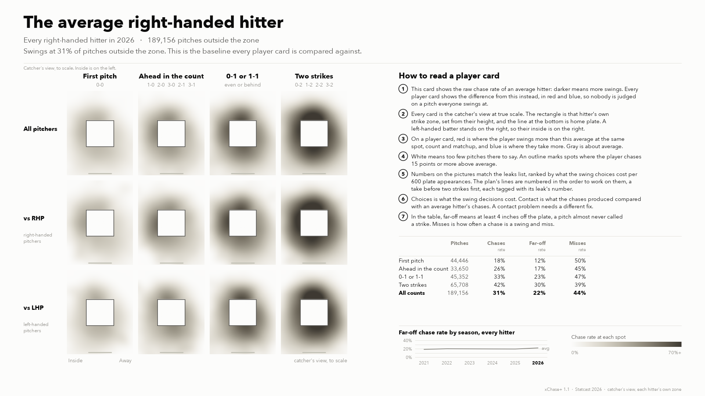
</picture>

**Does fixing a leak pay?** Hitters who cut their leak chasing 10 points more than their numbers predicted gained 1.4 to 2.0 runs per 600 PA (xwOBA) and 4.3 to 4.7 xChase+ points, with only 0.3 to 0.5 pts fewer swings at strikes. It paid about the same whether or not they hit well in those counts. Two cautions before promising a player anything. Season to season, most of the payoff came from the other direction: hitters who chased more than predicted lost 2.9 ± 1.1 runs of offense, while those who cut more gained 7.5 xChase+ points but only 0.3 ± 1.2 runs (half to half, both sides show it: +3.4 and −3.1). So the first promise to a hitter is fewer wasted counts, not a better slash line. And leaks shrink on their own: how far above the league a hitter chases in his leaks halves the next season with nobody doing anything, so the target under each plan is the number to beat, not the hitter's current rate.
(Step 16; see the main README for the method.)

**The target.** Under each plan, how far above the league's chase rate, in points,
the hitter chased in all of his card's leaks together in 2026 (on the backtest's
scale, so it need not match any one leak's rates), and what the season-to-season line
predicts for 2027 if he changes nothing (step 19, frozen before the season).
Leaks are a hitter's worst-looking spots, so about half of the excess goes away by
itself. A fix is a number under the prediction, not under this season's rate; that is
also how step 20 will score the card. A hitter whose prediction for next season is
about at the league's rate gets no target, and one whose leaks are all video items
gets no number.

**The count check.** Under each plan, how the hitter does once the count
reaches the counts his leaks are in: the xwOBA of every plate appearance
that got there, against the league's in the same counts (step 15). The
verdict uses an estimate shrunk for noise, so a small sample or a split that
doesn't repeat from year to year (being ahead in the count) can't swing it.
It is context, not a filter: step 16 found that hitters gained about as much
from fixing a leak whether they were hitting well in those counts or not.

## Easiest to improve

Their chases turn out about as well as an average hitter's or better, and the pattern repeats across seasons, so a take rule is most of the adjustment; where contact may be part of it, the coach's note says so.

### Salvador Pérez

xChase+ 73 (255 of 261). Far-off chases cost 16.9 runs per 600 PA. Choices −23.3, contact +7.8.

<picture>
  <source media="(prefers-color-scheme: dark)" srcset="cards/salvador_perez_dark.png">
  
</picture>

[Printable card, two pages (PDF)](print/salvador_perez.pdf)

**What to work on**

1. At 0-1 or 1-1, let breaking balls below the zone go. You swung at 74% of them; hitters on average swing at 42%. The ones you swung at were typically 4 inches off the zone. (leak ③)
2. With two strikes, let breaking balls below the zone go. You swung at 78% of them; hitters on average swing at 49%. The ones you swung at were typically 5 inches off the zone. (leak ①)
- Leak 2 (two strikes, mostly vs RHP, breaking balls away) costs more than line 1, but a take before two strikes costs you no strikeouts, so line 1 goes first. Your choices also cost about 3 runs a season on the first pitch and 7 when you're ahead in the count, spread over many pitches rather than one take.
- Keep swinging at strikes. The changes to start with are the pitches above.

**Count check.** Two strikes: .226 xwOBA once there, league .234; allowing for noise, about average (.231). 0-1 or 1-1: .278 xwOBA once there, league .276; allowing for noise, about average (.280).

**Target.** Leaks 1 to 3 together: you chased 24 points above the league's chase rate in 2026 (30 on the rows above; the target uses a simpler league rate, the one it is scored on). Those spots get better on their own, so with no change you'd be about 13 points above it in 2027. Under 13 is a fix.

**Coach's note, for the staff.** At 0-1 or 1-1, breaking balls below the zone: the plan's first line, where the take costs nothing in strikeouts. Volume, not contact: these chases turn out better than the league's, which softens every leak but erases none.

### Michael Harris

xChase+ 78 (251 of 261). Far-off chases cost 16.8 runs per 600 PA. Choices −21.8, contact +9.0.

<picture>
  <source media="(prefers-color-scheme: dark)" srcset="cards/michael_harris_dark.png">
  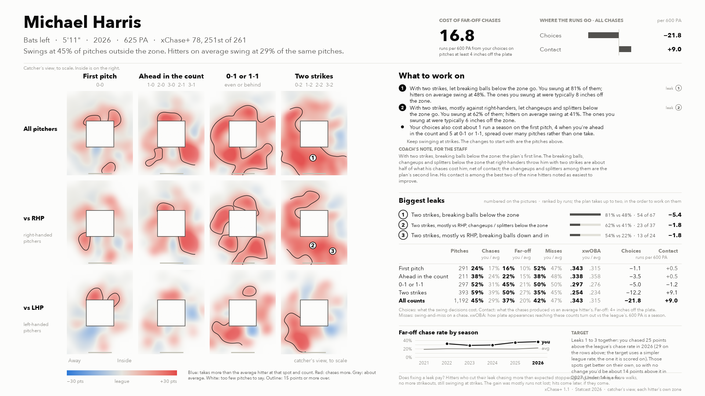
</picture>

[Printable card, two pages (PDF)](print/michael_harris.pdf)

**What to work on**

1. With two strikes, let breaking balls below the zone go. You swung at 81% of them; hitters on average swing at 48%. The ones you swung at were typically 8 inches off the zone. (leak ①)
2. With two strikes, mostly against right-handers, let changeups and splitters below the zone go. You swung at 62% of them; hitters on average swing at 41%. The ones you swung at were typically 6 inches off the zone. (leak ②)
- Your choices also cost about 1 run a season on the first pitch, 4 when you're ahead in the count and 5 at 0-1 or 1-1, spread over many pitches rather than one take.
- Keep swinging at strikes. The changes to start with are the pitches above.

**Count check.** Two strikes: .254 xwOBA once there, league .234; allowing for noise, hitting well (.252).

**Target.** Leaks 1 to 3 together: you chased 25 points above the league's chase rate in 2026 (29 on the rows above; the target uses a simpler league rate, the one it is scored on). Those spots get better on their own, so with no change you'd be about 14 points above it in 2027. Under 14 is a fix.

**Coach's note, for the staff.** With two strikes, breaking balls below the zone: the plan's first line. The breaking balls, changeups and splitters below the zone that right-handers throw him with two strikes are about half of what his chases cost him, net of contact; the changeups and splitters among them are the plan's second line. His contact is among the best two of the nine hitters noted as easiest to improve.

### Ernie Clement

xChase+ 74 (254 of 261). Far-off chases cost 13.8 runs per 600 PA. Choices −17.4, contact +3.2.

<picture>
  <source media="(prefers-color-scheme: dark)" srcset="cards/ernie_clement_dark.png">
  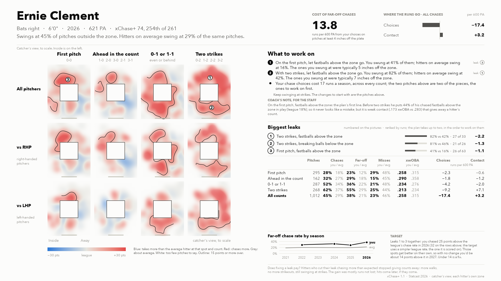
</picture>

[Printable card, two pages (PDF)](print/ernie_clement.pdf)

**What to work on**

1. On the first pitch, let fastballs above the zone go. You swung at 41% of them; hitters on average swing at 16%. The ones you swung at were typically 5 inches off the zone. (leak ③)
2. With two strikes, let fastballs above the zone go. You swung at 82% of them; hitters on average swing at 42%. The ones you swung at were typically 7 inches off the zone. (leak ①)
- Your chase choices cost 17 runs a season, across every count; the two pitches above are two of the pieces, the ones to work on first.
- Keep swinging at strikes. The changes to start with are the pitches above.

**Count check.** Two strikes: .213 xwOBA once there, league .234; allowing for noise, struggling (.211). First pitch: .258 xwOBA once there, league .315; allowing for noise, struggling (.275).

**Target.** Leaks 1 to 3 together: you chased 25 points above the league's chase rate in 2026 (32 on the rows above; the target uses a simpler league rate, the one it is scored on). Those spots get better on their own, so with no change you'd be about 14 points above it in 2027. Under 14 is a fix.

**Coach's note, for the staff.** On the first pitch, fastballs above the zone: the plan's first line. Before two strikes he puts 44% of his chased fastballs above the zone in play (league 18%), so it never looks like a mistake, but it is weak contact (.173 xwOBA vs .283) that gives away a hitter's count.

### Angel Martínez

xChase+ 87 (222 of 261). Far-off chases cost 12.6 runs per 600 PA. Choices −17.8, contact +9.3.

<picture>
  <source media="(prefers-color-scheme: dark)" srcset="cards/angel_martinez_dark.png">
  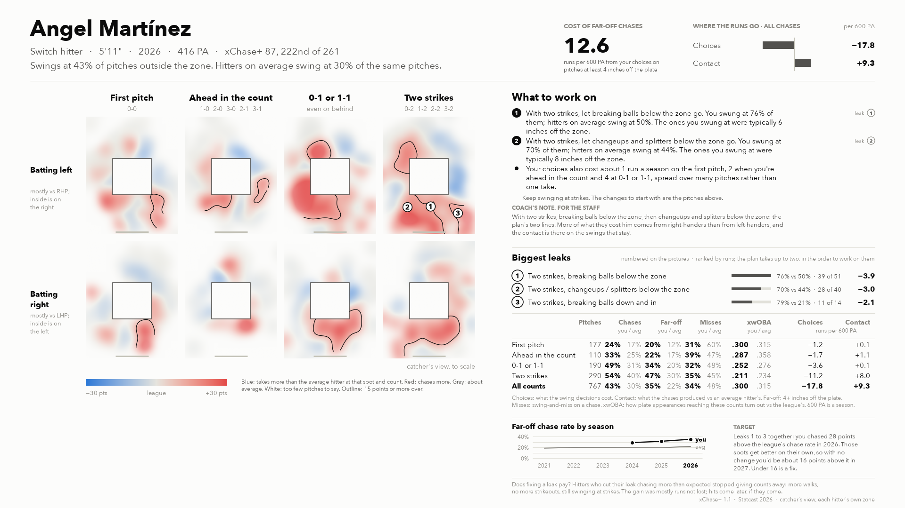
</picture>

[Printable card, two pages (PDF)](print/angel_martinez.pdf)

**What to work on**

1. With two strikes, let breaking balls below the zone go. You swung at 76% of them; hitters on average swing at 50%. The ones you swung at were typically 6 inches off the zone. (leak ①)
2. With two strikes, let changeups and splitters below the zone go. You swung at 70% of them; hitters on average swing at 44%. The ones you swung at were typically 8 inches off the zone. (leak ②)
- Your choices also cost about 1 run a season on the first pitch, 2 when you're ahead in the count and 4 at 0-1 or 1-1, spread over many pitches rather than one take.
- Keep swinging at strikes. The changes to start with are the pitches above.

**Count check.** Two strikes: .211 xwOBA once there, league .234; allowing for noise, struggling (.223).

**Target.** Leaks 1 to 3 together: you chased 28 points above the league's chase rate in 2026. Those spots get better on their own, so with no change you'd be about 16 points above it in 2027. Under 16 is a fix.

**Coach's note, for the staff.** With two strikes, breaking balls below the zone, then changeups and splitters below the zone: the plan's two lines. More of what they cost him comes from right-handers than from left-handers, and the contact is there on the swings that stay.

### Ceddanne Rafaela

xChase+ 86 (226 of 261). Far-off chases cost 12.2 runs per 600 PA. Choices −16.6, contact +8.5.

<picture>
  <source media="(prefers-color-scheme: dark)" srcset="cards/ceddanne_rafaela_dark.png">
  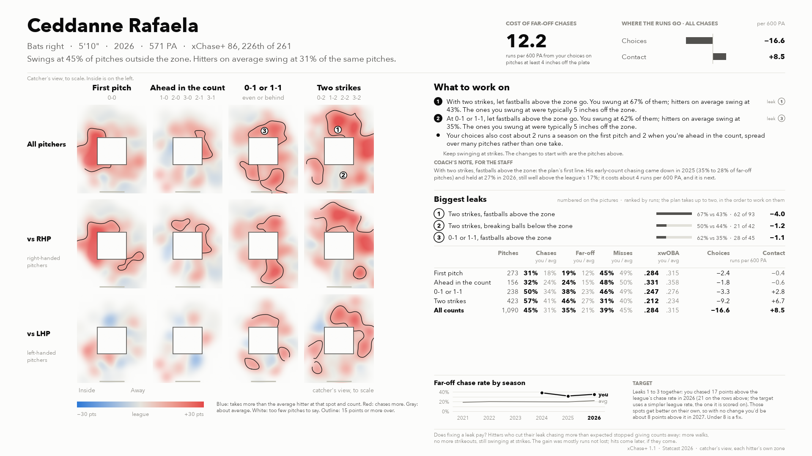
</picture>

[Printable card, two pages (PDF)](print/ceddanne_rafaela.pdf)

**What to work on**

1. With two strikes, let fastballs above the zone go. You swung at 67% of them; hitters on average swing at 43%. The ones you swung at were typically 5 inches off the zone. (leak ①)
2. At 0-1 or 1-1, let fastballs above the zone go. You swung at 62% of them; hitters on average swing at 35%. The ones you swung at were typically 5 inches off the zone. (leak ③)
- Your choices also cost about 2 runs a season on the first pitch and 2 when you're ahead in the count, spread over many pitches rather than one take.
- Keep swinging at strikes. The changes to start with are the pitches above.

**Count check.** Two strikes: .212 xwOBA once there, league .234; allowing for noise, struggling (.220). 0-1 or 1-1: .247 xwOBA once there, league .276; allowing for noise, struggling (.257).

**Target.** Leaks 1 to 3 together: you chased 17 points above the league's chase rate in 2026 (21 on the rows above; the target uses a simpler league rate, the one it is scored on). Those spots get better on their own, so with no change you'd be about 8 points above it in 2027. Under 8 is a fix.

**Coach's note, for the staff.** With two strikes, fastballs above the zone: the plan's first line. His early-count chasing came down in 2025 (35% to 28% of far-off pitches) and held at 27% in 2026, still well above the league's 17%; it costs about 4 runs per 600 PA, and it is next.

### José Caballero

xChase+ 79 (246 of 261). Far-off chases cost 11.7 runs per 600 PA. Choices −13.5, contact +1.4.

<picture>
  <source media="(prefers-color-scheme: dark)" srcset="cards/jose_caballero_dark.png">
  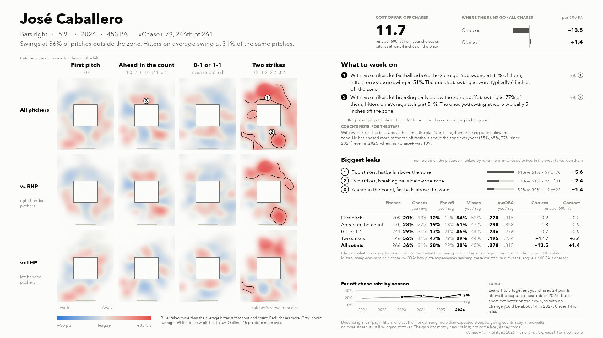
</picture>

[Printable card, two pages (PDF)](print/jose_caballero.pdf)

**What to work on**

1. With two strikes, let fastballs above the zone go. You swung at 81% of them; hitters on average swing at 51%. The ones you swung at were typically 6 inches off the zone. (leak ①)
2. With two strikes, let breaking balls below the zone go. You swung at 77% of them; hitters on average swing at 51%. The ones you swung at were typically 5 inches off the zone. (leak ②)
- Your choices also cost about 1 run a season when you're ahead in the count, where leak 3 is one for video with your coaches.
- Keep swinging at strikes. The changes to start with are the pitches above.

**Count check.** Two strikes: .195 xwOBA once there, league .234; allowing for noise, struggling (.211). Ahead in the count: .298 xwOBA once there, league .358; allowing for noise, struggling (.332).

**Target.** Leaks 1 to 3 together: you chased 24 points above the league's chase rate in 2026 (28 on the rows above; the target uses a simpler league rate, the one it is scored on). Those spots get better on their own, so with no change you'd be about 14 points above it in 2027. Under 14 is a fix.

**Coach's note, for the staff.** With two strikes, fastballs above the zone: the plan's first line, then breaking balls below the zone. He has chased more of the far-off (4+ inch) fastballs above the zone with two strikes every year (55%, 65%, 77% since 2024; 81% in 2026 counting the near ones, as the leak list does), even in 2025, when his xChase+ was 109.

### Hunter Goodman

xChase+ 78 (249 of 261). Far-off chases cost 10.0 runs per 600 PA. Choices −14.8, contact +1.2.

<picture>
  <source media="(prefers-color-scheme: dark)" srcset="cards/hunter_goodman_dark.png">
  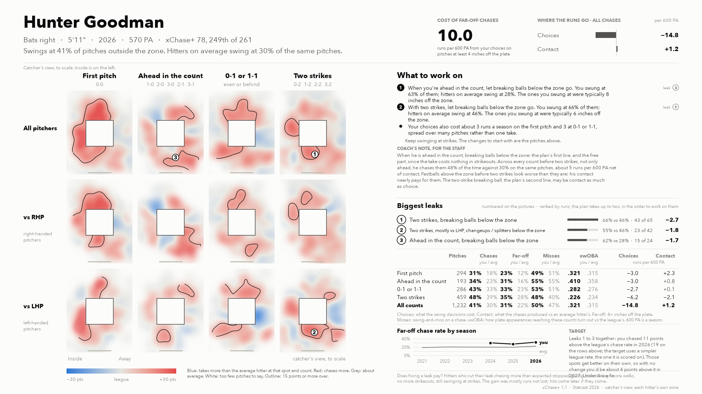
</picture>

[Printable card, two pages (PDF)](print/hunter_goodman.pdf)

**What to work on**

1. When you're ahead in the count, let breaking balls below the zone go. You swung at 63% of them; hitters on average swing at 28%. The ones you swung at were typically 8 inches off the zone. (leak ③)
2. With two strikes, let breaking balls below the zone go. You swung at 66% of them; hitters on average swing at 46%. The ones you swung at were typically 6 inches off the zone. (leak ①)
- Your choices also cost about 3 runs a season on the first pitch and 3 at 0-1 or 1-1, spread over many pitches rather than one take.
- Keep swinging at strikes. The changes to start with are the pitches above.

**Count check.** Two strikes: .226 xwOBA once there, league .234; allowing for noise, about average (.231). Ahead in the count: .410 xwOBA once there, league .358; allowing for noise, hitting well (.370).

**Target.** Leaks 1 to 3 together: you chased 11 points above the league's chase rate in 2026 (19 on the rows above; the target uses a simpler league rate, the one it is scored on). Those spots get better on their own, so with no change you'd be about 4 points above it in 2027. Under 4 is a fix.

**Coach's note, for the staff.** When he is ahead in the count, breaking balls below the zone: the plan's first line, and the free part, since the take costs nothing in strikeouts. Across every count before two strikes, not only ahead, he chases them 48% of the time against 30% on the same pitches, about 5 runs per 600 PA net of contact. Fastballs above the zone before two strikes look worse than they are: his contact nearly pays for them. The two-strike breaking ball, the plan's second line, may be contact as much as choice.

### Ozzie Albies

xChase+ 82 (239 of 261). Far-off chases cost 8.5 runs per 600 PA. Choices −13.3, contact +3.6.

<picture>
  <source media="(prefers-color-scheme: dark)" srcset="cards/ozzie_albies_dark.png">
  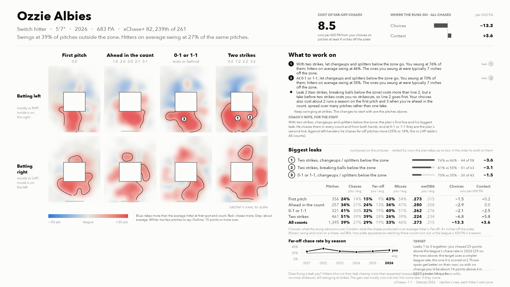
</picture>

[Printable card, two pages (PDF)](print/ozzie_albies.pdf)

**What to work on**

1. With two strikes, let changeups and splitters below the zone go. You swung at 76% of them; hitters on average swing at 46%. The ones you swung at were typically 7 inches off the zone. (leak ①)
2. At 0-1 or 1-1, let changeups and splitters below the zone go. You swung at 70% of them; hitters on average swing at 35%. The ones you swung at were typically 7 inches off the zone. (leak ③)
- Leak 2 (two strikes, breaking balls below the zone) costs more than line 2, but a take before two strikes costs you no strikeouts, so line 2 goes first. Your choices also cost about 2 runs a season on the first pitch and 3 when you're ahead in the count, spread over many pitches rather than one take.
- Keep swinging at strikes. The changes to start with are the pitches above.

**Count check.** Two strikes: .224 xwOBA once there, league .234; allowing for noise, about average (.224). 0-1 or 1-1: .262 xwOBA once there, league .276; allowing for noise, struggling (.258).

**Target.** Leaks 1 to 3 together: you chased 25 points above the league's chase rate in 2026 (29 on the rows above; the target uses a simpler league rate, the one it is scored on). Those spots get better on their own, so with no change you'd be about 14 points above it in 2027. Under 14 is a fix.

**Coach's note, for the staff.** With two strikes, changeups and splitters below the zone: the plan's first line and his biggest leak. He chases them in every count and from both hands, and at 0-1 or 1-1 they are the plan's second line. Against left-handers he chases far-off pitches more (35% vs 18%, the vs LHP table's All counts).

### Luis García

xChase+ 86 (225 of 261). Far-off chases cost 8.4 runs per 600 PA. Choices −14.9, contact +5.9.

<picture>
  <source media="(prefers-color-scheme: dark)" srcset="cards/luis_garcia_dark.png">
  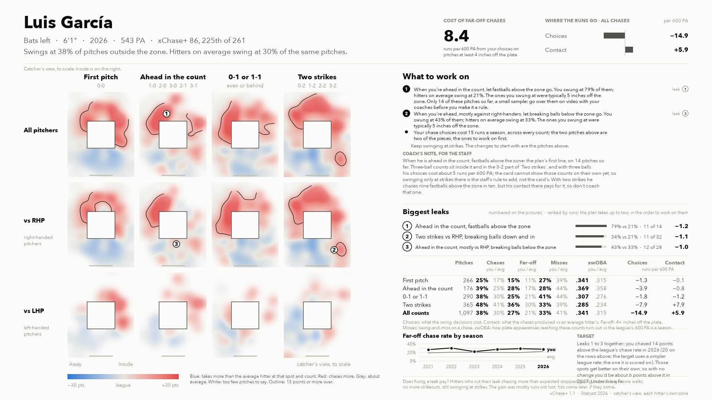
</picture>

[Printable card, two pages (PDF)](print/luis_garcia.pdf)

**What to work on**

1. When you're ahead in the count, let fastballs above the zone go. You swung at 79% of them; hitters on average swing at 21%. The ones you swung at were typically 5 inches off the zone. Only 14 of these pitches so far, a small sample: go over them on video with your coaches before you make it a rule. (leak ①)
2. When you're ahead, mostly against right-handers, let breaking balls below the zone go. You swung at 43% of them; hitters on average swing at 33%. The ones you swung at were typically 5 inches off the zone. (leak ③)
- Your chase choices cost 15 runs a season, across every count; the two pitches above are two of the pieces, the ones to work on first.
- Keep swinging at strikes. The changes to start with are the pitches above.

**Count check.** Ahead in the count: .369 xwOBA once there, league .358; allowing for noise, hitting well (.377). Two strikes: .285 xwOBA once there, league .234; allowing for noise, hitting well (.269).

**Target.** Leaks 1 to 3 together: you chased 14 points above the league's chase rate in 2026 (20 on the rows above; the target uses a simpler league rate, the one it is scored on). Those spots get better on their own, so with no change you'd be about 6 points above it in 2027. Under 6 is a fix.

**Coach's note, for the staff.** When he is ahead in the count, fastballs above the zone: the plan's first line, on 14 pitches so far. Three-ball counts sit inside it and in the 3-2 part of 'Two strikes', and with three balls his choices cost about 5 runs per 600 PA; the card cannot show those counts on their own yet, so swinging only at strikes there is the staff's rule to add, not the card's. With two strikes he chases nine fastballs above the zone in ten, but his contact there pays for it, so don't coach that one.

## Biggest losses

The rest of the bottom 10 by xChase+. Larger losses, but spread wider, and for two of them the problem is contact as much as choice.

### Mickey Moniak

xChase+ 55 (261 of 261). Far-off chases cost 13.5 runs per 600 PA. Choices −18.5, contact −6.5.

<picture>
  <source media="(prefers-color-scheme: dark)" srcset="cards/mickey_moniak_dark.png">
  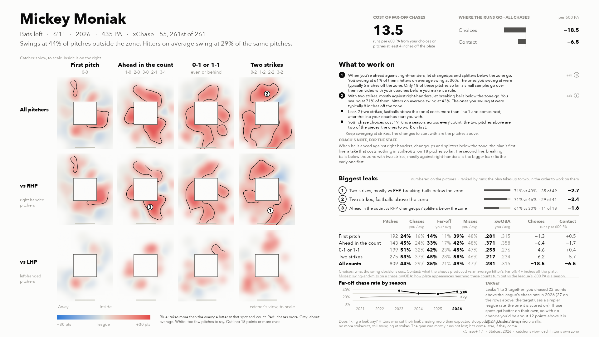
</picture>

[Printable card, two pages (PDF)](print/mickey_moniak.pdf)

**What to work on**

1. When you're ahead against right-handers, let changeups and splitters below the zone go. You swung at 61% of them; hitters on average swing at 30%. The ones you swung at were typically 5 inches off the zone. Only 18 of these pitches so far, a small sample: go over them on video with your coaches before you make it a rule. (leak ③)
2. With two strikes, mostly against right-handers, let breaking balls below the zone go. You swung at 71% of them; hitters on average swing at 43%. The ones you swung at were typically 8 inches off the zone. (leak ①)
- Leak 2 (two strikes, fastballs above the zone) costs more than line 1 and comes next, after the line your coaches start you with.
- Your chase choices cost 19 runs a season, across every count; the two pitches above are two of the pieces, the ones to work on first.
- Keep swinging at strikes. The changes to start with are the pitches above.

**Count check.** Two strikes: .217 xwOBA once there, league .234; allowing for noise, about average (.224). Ahead in the count: .371 xwOBA once there, league .358; allowing for noise, struggling (.342).

**Target.** Leaks 1 to 3 together: you chased 22 points above the league's chase rate in 2026 (27 on the rows above; the target uses a simpler league rate, the one it is scored on). Those spots get better on their own, so with no change you'd be about 12 points above it in 2027. Under 12 is a fix.

**Coach's note, for the staff.** When he is ahead against right-handers, changeups and splitters below the zone: the plan's first line, a take that costs nothing in strikeouts, on 18 pitches so far. The second line, breaking balls below the zone with two strikes, mostly against right-handers, is the bigger leak; fix the early one first.

### Ezequiel Tovar

xChase+ 66 (260 of 261). Far-off chases cost 12.0 runs per 600 PA. Choices −18.2, contact −1.0.

<picture>
  <source media="(prefers-color-scheme: dark)" srcset="cards/ezequiel_tovar_dark.png">
  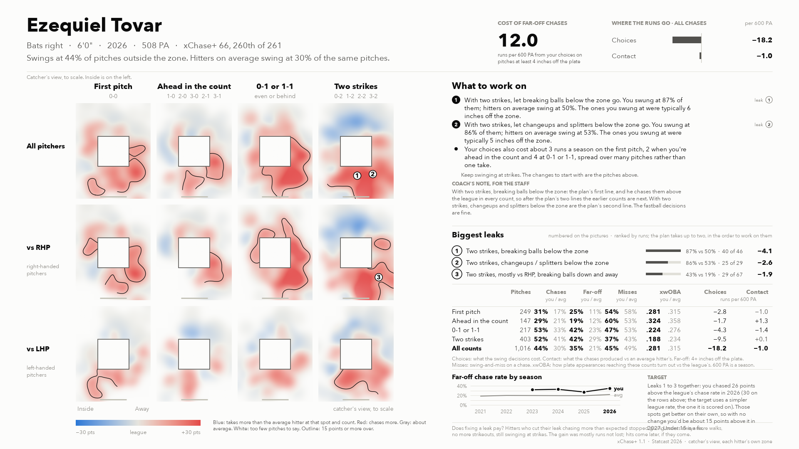
</picture>

[Printable card, two pages (PDF)](print/ezequiel_tovar.pdf)

**What to work on**

1. With two strikes, let breaking balls below the zone go. You swung at 87% of them; hitters on average swing at 50%. The ones you swung at were typically 6 inches off the zone. (leak ①)
2. With two strikes, let changeups and splitters below the zone go. You swung at 86% of them; hitters on average swing at 53%. The ones you swung at were typically 5 inches off the zone. (leak ②)
- Your choices also cost about 3 runs a season on the first pitch, 2 when you're ahead in the count and 4 at 0-1 or 1-1, spread over many pitches rather than one take.
- Keep swinging at strikes. The changes to start with are the pitches above.

**Count check.** Two strikes: .188 xwOBA once there, league .234; allowing for noise, struggling (.205).

**Target.** Leaks 1 to 3 together: you chased 26 points above the league's chase rate in 2026 (30 on the rows above; the target uses a simpler league rate, the one it is scored on). Those spots get better on their own, so with no change you'd be about 15 points above it in 2027. Under 15 is a fix.

**Coach's note, for the staff.** With two strikes, breaking balls below the zone: the plan's first line, and he chases them above the league in every count, so after the plan's two lines the earlier counts are next. With two strikes, changeups and splitters below the zone are the plan's second line. The fastball decisions are fine.

### Zach Neto

xChase+ 71 (256 of 261). Far-off chases cost 10.5 runs per 600 PA. Choices −13.1, contact −2.7.

<picture>
  <source media="(prefers-color-scheme: dark)" srcset="cards/zach_neto_dark.png">
  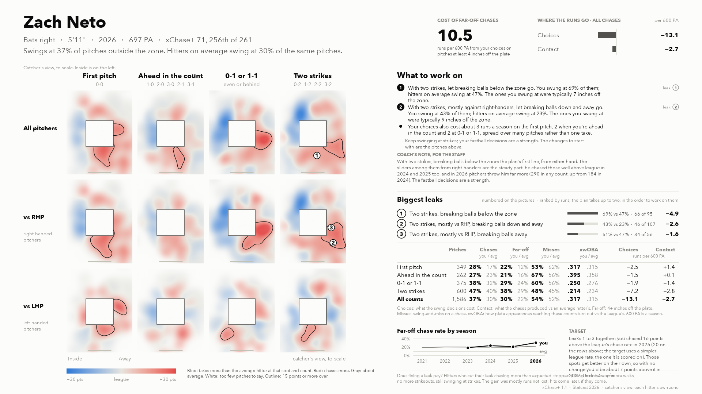
</picture>

[Printable card, two pages (PDF)](print/zach_neto.pdf)

**What to work on**

1. With two strikes, let breaking balls below the zone go. You swung at 69% of them; hitters on average swing at 47%. The ones you swung at were typically 7 inches off the zone. (leak ①)
2. With two strikes, mostly against right-handers, let breaking balls down and away go. You swung at 43% of them; hitters on average swing at 23%. The ones you swung at were typically 9 inches off the zone. (leak ②)
- Your choices also cost about 3 runs a season on the first pitch, 2 when you're ahead in the count and 2 at 0-1 or 1-1, spread over many pitches rather than one take.
- Keep swinging at strikes; your fastball decisions are a strength. The changes to start with are the pitches above.

**Count check.** Two strikes: .214 xwOBA once there, league .234; allowing for noise, struggling (.221).

**Target.** Leaks 1 to 3 together: you chased 16 points above the league's chase rate in 2026 (20 on the rows above; the target uses a simpler league rate, the one it is scored on). Those spots get better on their own, so with no change you'd be about 7 points above it in 2027. Under 7 is a fix.

**Coach's note, for the staff.** With two strikes, breaking balls below the zone: the plan's first line, from either hand. The sliders among them from right-handers are the steady part: he chased those well above league in 2024 and 2025 too, and in 2026 pitchers threw him far more (290 in any count, up from 184 in 2024). The fastball decisions are a strength.

### Andrés Giménez

xChase+ 67 (259 of 261). Far-off chases cost 10.0 runs per 600 PA. Choices −14.9, contact −2.5.

<picture>
  <source media="(prefers-color-scheme: dark)" srcset="cards/andres_gimenez_dark.png">
  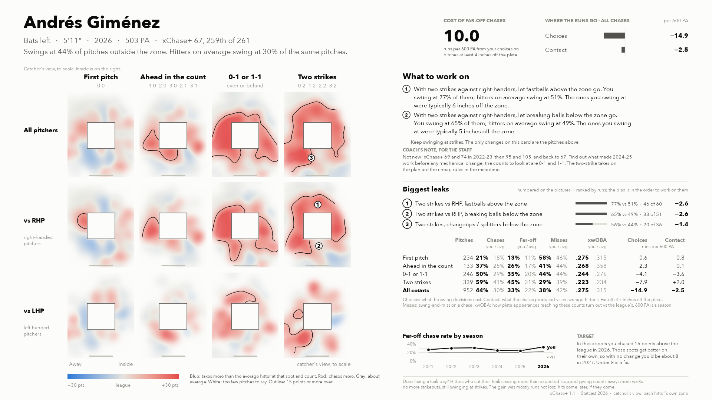
</picture>

[Printable card, two pages (PDF)](print/andres_gimenez.pdf)

**What to work on**

1. With two strikes, mostly against right-handers, let fastballs above the zone go. You swung at 77% of them; hitters on average swing at 51%. The ones you swung at were typically 6 inches off the zone. (leak ①)
2. With two strikes, mostly against right-handers, let breaking balls below the zone go. You swung at 65% of them; hitters on average swing at 49%. The ones you swung at were typically 5 inches off the zone. (leak ②)
- Your choices also cost about 2 runs a season when you're ahead in the count and 4 at 0-1 or 1-1, spread over many pitches rather than one take.
- Keep swinging at strikes. The changes to start with are the pitches above.

**Count check.** Two strikes: .223 xwOBA once there, league .234; allowing for noise, about average (.227).

**Target.** Leaks 1 to 3 together: you chased 16 points above the league's chase rate in 2026 (19 on the rows above; the target uses a simpler league rate, the one it is scored on). Those spots get better on their own, so with no change you'd be about 8 points above it in 2027. Under 8 is a fix.

**Coach's note, for the staff.** With two strikes, mostly against right-handers, fastballs above the zone, then breaking balls below the zone: the plan's two lines, the cheap rules while the staff looks into the rest. Not new: xChase+ 69 and 74 in 2022-23, then 95 and 105, and back to 67, so find out what made 2024-25 work before any mechanical change. His biggest net loss by count is at 0-1 and 1-1, where none of his three biggest leaks sits, which is why the plan starts with two strikes.

### Jeremy Peña

xChase+ 76 (252 of 261). Far-off chases cost 8.8 runs per 600 PA. Choices −12.7, contact −1.9.

<picture>
  <source media="(prefers-color-scheme: dark)" srcset="cards/jeremy_pena_dark.png">
  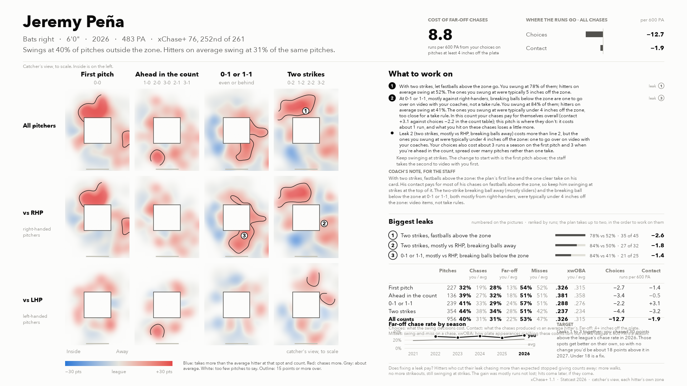
</picture>

[Printable card, two pages (PDF)](print/jeremy_pena.pdf)

**What to work on**

1. With two strikes, let fastballs above the zone go. You swung at 78% of them; hitters on average swing at 52%. The ones you swung at were typically 5 inches off the zone. (leak ①)
2. At 0-1 or 1-1, mostly against right-handers, breaking balls below the zone are one to go over on video with your coaches, not a take rule. You swung at 84% of them; hitters on average swing at 41%. The ones you swung at were typically under 4 inches off the zone, too close for a take rule. In this count your chases pay for themselves overall (contact +3.1 against choices −2.2 in the count table); this pitch is where they don't: it costs about 1 run, and what you hit on these chases loses a little more. (leak ③)
- Leak 2 (two strikes, mostly vs RHP, breaking balls away) costs more than line 2, but the ones you swung at were typically under 4 inches off the zone: one to go over on video with your coaches. Your choices also cost about 3 runs a season on the first pitch and 3 when you're ahead in the count, spread over many pitches rather than one take.
- Keep swinging at strikes. The change to start with is the first pitch above; the staff takes the second to video with you first.

**Count check.** Two strikes: .237 xwOBA once there, league .234; allowing for noise, about average (.240). 0-1 or 1-1: .288 xwOBA once there, league .276; allowing for noise, hitting well (.287).

**Target.** Leaks 1 to 3 together: you chased 30 points above the league's chase rate in 2026. Those spots get better on their own, so with no change you'd be about 18 points above it in 2027. Under 18 is a fix.

**Coach's note, for the staff.** With two strikes, fastballs above the zone: the plan's first line and the one clear take on his card. His contact pays for most of his chases on fastballs above the zone, so keep him swinging at strikes at the top of it. The two-strike breaking ball away (mostly sliders) and the breaking ball below the zone at 0-1 or 1-1, both mostly from right-handers, were typically under 4 inches off the zone: video items, not take rules.

### Oswald Peraza

xChase+ 76 (253 of 261). Far-off chases cost 7.6 runs per 600 PA. Choices −13.8, contact −1.0.

<picture>
  <source media="(prefers-color-scheme: dark)" srcset="cards/oswald_peraza_dark.png">
  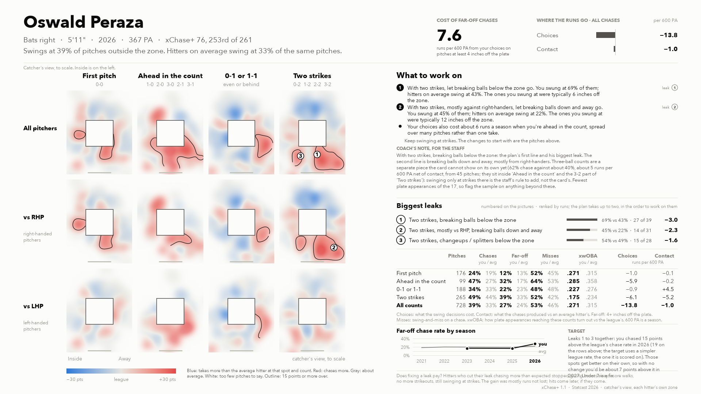
</picture>

[Printable card, two pages (PDF)](print/oswald_peraza.pdf)

**What to work on**

1. With two strikes, let breaking balls below the zone go. You swung at 69% of them; hitters on average swing at 43%. The ones you swung at were typically 6 inches off the zone. (leak ①)
2. With two strikes, mostly against right-handers, let breaking balls down and away go. You swung at 45% of them; hitters on average swing at 22%. The ones you swung at were typically 12 inches off the zone. (leak ②)
- Your choices also cost about 6 runs a season when you're ahead in the count, spread over many pitches rather than one take.
- Keep swinging at strikes. The changes to start with are the pitches above.

**Count check.** Two strikes: .175 xwOBA once there, league .234; allowing for noise, struggling (.201).

**Target.** Leaks 1 to 3 together: you chased 15 points above the league's chase rate in 2026 (19 on the rows above; the target uses a simpler league rate, the one it is scored on). Those spots get better on their own, so with no change you'd be about 7 points above it in 2027. Under 7 is a fix.

**Coach's note, for the staff.** With two strikes, breaking balls below the zone: the plan's first line and his biggest leak. The second line is breaking balls down and away, mostly from right-handers. Three-ball counts are a separate piece the card cannot show on its own yet (62% chase against about 40%, about 5 runs per 600 PA net of contact, from 45 pitches; they sit inside 'Ahead in the count' and the 3-2 part of 'Two strikes'): swinging only at strikes there is the staff's rule to add, not the card's. Fewest plate appearances of the 17, so flag the sample on anything beyond these.

### Jarren Duran

xChase+ 68 (258 of 261). Far-off chases cost 4.6 runs per 600 PA. Choices −6.7, contact −10.2.

<picture>
  <source media="(prefers-color-scheme: dark)" srcset="cards/jarren_duran_dark.png">
  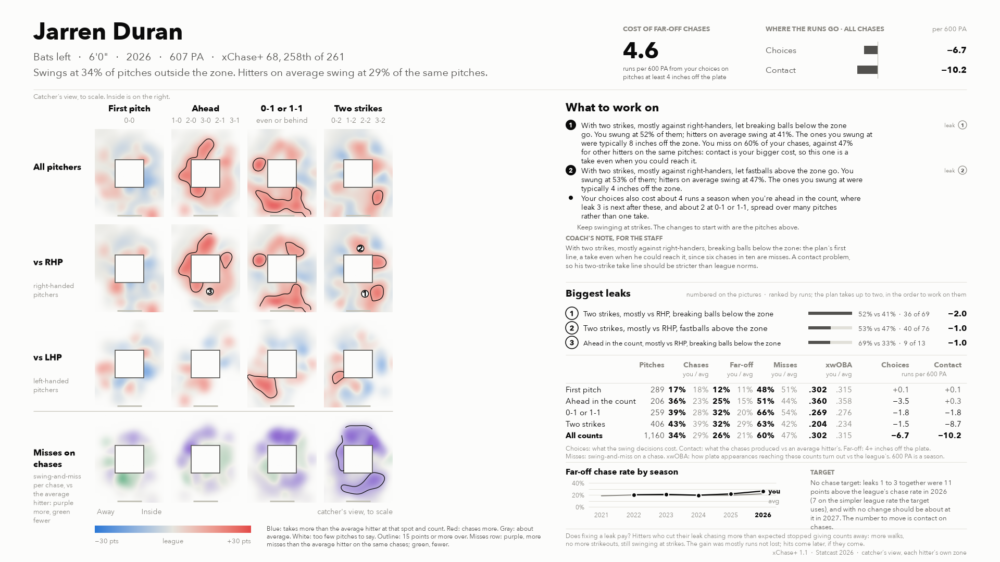
</picture>

[Printable card, two pages (PDF)](print/jarren_duran.pdf)

**What to work on**

1. With two strikes, mostly against right-handers, let breaking balls below the zone go. You swung at 52% of them; hitters on average swing at 41%. The ones you swung at were typically 8 inches off the zone. You miss on 60% of your chases, against 47% for other hitters on the same pitches: contact is your bigger cost, so this one is a take even when you could reach it. (leak ①)
2. With two strikes, mostly against right-handers, let fastballs above the zone go. You swung at 53% of them; hitters on average swing at 47%. The ones you swung at were typically 4 inches off the zone. (leak ②)
- Your choices also cost about 4 runs a season when you're ahead in the count, where leak 3 is next after these, and about 2 at 0-1 or 1-1, spread over many pitches rather than one take.
- Keep swinging at strikes. The changes to start with are the pitches above.

**Count check.** Two strikes: .204 xwOBA once there, league .234; allowing for noise, struggling (.215). Ahead in the count: .360 xwOBA once there, league .358; allowing for noise, about average (.353).

**Target.** No chase target: leaks 1 to 3 together were 11 points above the league's chase rate in 2026 (7 on the simpler league rate the target uses), and with no change should be about at it in 2027. The number to move is contact on chases.

**Coach's note, for the staff.** With two strikes, mostly against right-handers, breaking balls below the zone: the plan's first line, a take even when he could reach it, since six chases in ten are misses. A contact problem, so his two-strike take line should be stricter than league norms.

### Colson Montgomery

xChase+ 68 (257 of 261). Far-off chases cost 3.1 runs per 600 PA. Choices −3.6, contact −13.0.

<picture>
  <source media="(prefers-color-scheme: dark)" srcset="cards/colson_montgomery_dark.png">
  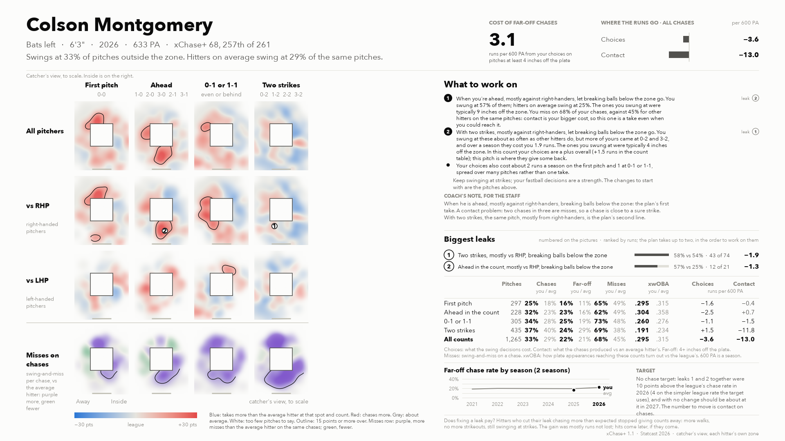
</picture>

[Printable card, two pages (PDF)](print/colson_montgomery.pdf)

**What to work on**

1. When you're ahead, mostly against right-handers, let breaking balls below the zone go. You swung at 57% of them; hitters on average swing at 25%. The ones you swung at were typically 9 inches off the zone. You miss on 68% of your chases, against 45% for other hitters on the same pitches: contact is your bigger cost, so this one is a take even when you could reach it. (leak ②)
2. With two strikes, mostly against right-handers, let breaking balls below the zone go. You swung at these about as often as other hitters do, but more of yours came at 0-2 and 3-2, and over a season they cost you 1.9 runs. The ones you swung at were typically 4 inches off the zone. In this count your choices are a plus overall (+1.5 runs in the count table); this pitch is where they give some back. (leak ①)
- Your choices also cost about 2 runs a season on the first pitch and 1 at 0-1 or 1-1, spread over many pitches rather than one take.
- Keep swinging at strikes; your fastball decisions are a strength. The changes to start with are the pitches above.

**Count check.** Two strikes: .191 xwOBA once there, league .234; allowing for noise, struggling (.205). Ahead in the count: .304 xwOBA once there, league .358; allowing for noise, struggling (.340).

**Target.** No chase target: leaks 1 and 2 together were 10 points above the league's chase rate in 2026 (4 on the simpler league rate the target uses), and with no change should be about at it in 2027. The number to move is contact on chases.

**Coach's note, for the staff.** When he is ahead, mostly against right-handers, breaking balls below the zone: the plan's first take. A contact problem: two chases in three are misses, so a chase is close to a sure strike. With two strikes, the same pitch, mostly from right-handers, is the plan's second line.
